# 论文骨架与完整研究交接：轨迹残差预算与源特征记忆

**项目所有者：leiyurun3-sudo。交接日期：2026-10-27。实验终点：R73。**

本文是交给论文作者及 Gemini 审阅的单一主文档，集中保存研究问题、算法、实现、结果、贡献定位、论文大纲和后续工作。对应代码与原始结果随仓库保存。正文数字来自 R71–R73 原始 CSV；早期对话报告用于交代探索过程，不并入主表。

## 1. 交付结论

实验已进入**数据冻结与论文写作交接**阶段。R71、R72、R73 分别完成 90、60、16 个输出，全部运行完成；合计 **166 个新生成输出，其中 160 个编辑输出、6 个重建诊断输出**。复用图片按原始 job ID 去重，不作为新增样本。数据覆盖 6 张独立源图、7 个编辑任务；R73 在其中 4 个任务上完成 8 组 task/seed 配对。

当前最清楚的论文主线是：**把轨迹残差校正的“施加多少”和“何时施加”拆开测量，在保持目标文本注意力贡献的源 KV 读取框架中，研究局部纹理保持、语义编辑与生成伪影之间的关系。**

R73 在相同累计残差 RMS 预算下，早校正、恒定校正、晚校正的平均位移补偿 NCC 分别为 **0.3783、0.3507、0.3343**。早校正相对恒定校正增加 **0.0276**，相对晚校正增加 **0.0440**。逐图观察同时显示：晚校正的杯子夜景更明确，早校正更接近源人物的姿态与脸部；两种调度都存在特定图案重画，狗的色偏也仍存在。这为论文提供了一个可解释的时间分配实验与实际边界。

**交付内容已经齐备：方法实现、原始结果、所有对比图、参数、逐步日志、成本记录和本文。** 稿件定稿需要完成语义评分及一个最接近外部方法的同协议比较。此仓库保存当前实验终点，本次交接没有追加 GPU 实验。

### 1.1 建议题目

**英文：Trajectory Residual Budgets and Source Memory for Rectified-Flow Image Editing**

**中文：面向 Rectified Flow 图像编辑的轨迹残差预算与源特征记忆**

这个题目覆盖已经实现的机制及本轮最完整的实验。最终摘要重点放在具体任务上的结果、预算控制和失败模式。统一语义评分完成后，再决定是否将“improved pattern preservation”加入标题。

### 1.2 建议保留的配置

| 配置 | 交接用途 | 已观察到的特点 |
|---|---|---|
| R71 `CORR_KV` | 完整方法的强保持参照 | 印花/普通 T 恤局部保持较好；杯子可能增加杂物，狗有紫偏 |
| R72 `C50` | 中等校正参照 | 狗雨天两张相对干净；杯子与地毯仍重画图案 |
| R73 `BUDGET_EARLY` | 等残差预算下的早校正机制实验 | 平均 NCC 略高，杯子/人物与晚校正表现不同 |
| R73 `BUDGET_LATE` | 等残差预算下的晚校正机制实验 | 杯子夜景明确，狗颜色较自然，地面编辑较弱 |
| `ETA03` | RF 控制器内部基线 | 部分人物出现重影，狗雨天环境变化明确 |

保留以上配置和全部结果，可以写完整的机制分析。统一默认配置的选择依据是联合成功率，而非只按 NCC 排序。

## 2. 研究问题与探索路径

研究目标是：给定真实图像与目标文本，在改变环境、光照或配色时，尽量保留主体的特定图案、细结构和数量。音乐杯的音符位置、印花衣服的徽标、地毯细格是比“仍然是杯子/衣服/地毯”更严格的保持目标。

此前探索经历了四个阶段：

1. **空间 mask 与注意力图控制。** 局部属性编辑能够保住区域外内容，细结构和图案仍会被重画。分辨率、色度变换属于独立工程变量。
2. **全局 RF 编辑与源 KV。** 源特征读取会改变输出的纹理与主体保持，也会影响场景改变和姿态。进入无生成 mask 的实验，以便观察源记忆的独立作用。
3. **轨迹残差校正。** 通过源轨迹与源条件速度之差构造校正项。重建诊断显著降低误差；编辑时校正与源 KV 的组合产生更强的保持效果，也暴露重复物体、色偏与编辑减弱。
4. **时间预算实验。** R72 控制系数的时间积分，R73 进一步控制实际施加残差的累计 RMS，从而直接比较早期、均匀、晚期校正。

这些观察引出本稿的核心问题：**在相同源残差投入下，把校正放在不同时间位置，能否改变编辑与保持的分配？源 KV 怎样影响这一过程？**

## 3. 算法定义：与实际代码一致

### 3.1 符号与时间方向

| 符号 | 含义 |
|---|---|
| `y` | 源图经 VAE 编码并打包后的 latent |
| `r_i` | 反演轨迹在生成方向第 i 个节点的源参考 latent |
| `z_i` | 正在编辑的目标 latent |
| `σ_i` | 生成噪声时间，从 1 降到 0 |
| `h_i=σ_i−σ_{i+1}>0` | 正的积分步长 |
| `fθ` | FLUX 网络输出的速度场 |
| `u_s,u_t` | 按当前生成方向写出的源/目标控制速度 |
| `p_i` | 参考轨迹的离散路径速度 |
| `c_i` | 源路径速度相对源条件速度的残差 |
| `λ_i` | 轨迹校正系数 |
| `g_i` | 注意力源记忆混合系数 |

所有公式采用本仓库的 sigma 方向。生成早期 sigma 大、后期 sigma 小，因此 `λ_i∝σ_i` 对应早强晚弱。

### 3.2 源反演

源反演使用空文本和 guidance embedding 0，在递增时间上执行：

\[
z\leftarrow z+h\left[(1-\gamma)f_\theta(z,t,\varnothing,0)
+\gamma\frac{\epsilon-z}{1-t}\right],\qquad\gamma=0.5.
\]

`ε` 使用 job seed 采样。28 步完成后反转 checkpoint 列表，获得生成方向的 `r_0,…,r_T`。源/目标文本编辑均从同一反演终点出发。

源反演由 `rf_kv.py::invert` 实现；它与编辑阶段的源条件前向具有不同的文本、guidance 和状态取值。记录反演速度后直接替换编辑源速度，会改变当前算法。

### 3.3 RF 控制器

当前工程将生成方向的速度写成：

\[
u(z,\sigma,p)=-(1-\eta_i)f_\theta(z,\sigma,p,3.5)
+\eta_i\frac{y-z}{\sigma}.
\]

`ETA03` 的实际代码是

\[
\eta_i=0.3\,\mathrm{clip}\left((\sigma_i-0.2)/0.25,0,1\right).
\]

所以臂名里的 0.3 是最大值，末段会衰减。论文复现必须给出这个调度。R73 两个新臂均取 `eta=0`。

### 3.4 轨迹残差校正

在源参考节点计算：

\[
p_i=\frac{r_{i+1}-r_i}{h_i},\quad
u_i^s=u(r_i,\sigma_i,p_s),\quad c_i=p_i-u_i^s.
\]

目标更新为：

\[
\boxed{z_{i+1}=z_i+h_i\left[u_i^t(z_i)+\lambda_i c_i\right].}
\]

全图更新时，这正是 `engine.py::execute` 中 `proposal=z+h*path+h*mask*residual` 的化简形式，其中 `mask=1`、`residual=u_t+λc−path`。

`c_i` 同时包含参考路径、反演控制与源条件生成之间的差异。它是一条源参考残差通道，不能简单等同于纯 Euler 截断误差。目标提示词不同或注意力注入开启时，即使 λ=1，目标速度仍可以偏离源速度，编辑仍会发生。

**重建性质。** 在同提示词、同网络计算、关闭 KV、相同控制速度、`z_i=r_i`、λ=1 的条件下：

\[
z_{i+1}=r_i+h_i[u_i^s+(p_i-u_i^s)]=r_{i+1}.
\]

这个代数性质解释了逐步跟随源路径。实际图像误差还包含 VAE 编解码、数值计算与预览压缩。R71 三个重建诊断的 corrected MAE 为 0.0508、0.0087、0.0238。

λ=0 会去掉残差项。它与 RAW 的对应关系还要求记忆开关、提示词、随机种子等设置一致；λ=0 且 KV 开启时，对应 KV-only 编辑臂。

### 3.5 源 KV：保留目标文本贡献与原始图像注意力质量

当前模式是 `attn_budget`，与早期纯 `softmax(Q_tK_s^T)V_s` 替换分支有区别。对目标图像 query，先计算原始联合注意力：

\[
A=\mathrm{softmax}(Q_t[K_{text}^t;K_{img}^t]^\top/\sqrt d),
\quad m_{img}=\sum_{j\in img}A_j.
\]

源图像内容读取为：

\[
R_s=\mathrm{softmax}(Q_t(K_{img}^s)^\top/\sqrt d)V_{img}^s.
\]

修改后的注意力输出：

\[
O_{mem}=A_{text}V_{text}^t+m_{img}R_s,\qquad
O'=O+g_i(O_{mem}-O).
\]

目标文本 token 的贡献和原始 image attention mass 在该次注意力计算中保留；image mass 内的内容来自源图。后续网络层会继续传播这些变化，因此这一局部代数性质与最终语义编辑达成需要分别测量。

代码在源参考前向中捕获经过归一化与 RoPE 的图像 K，以及图像 V。随后目标分支用自己的 Q 读取源记忆。当前实际修改的是 **`single_transformer_blocks[1:27]`，即索引 1–26 的单流块**。旧报告中“双流 1–26”的表述应修正。`value_blocks=32–37` 是历史配置字段，本轮 `attn_budget` 的主要注入位置由 `attention_blocks` 决定。

R73：前 7 个生成步启用源记忆（i=0,…,6），`gate=1`，paired K/V，无空间门控。生成 mask 是全 1；`outer.png` 仅参与对象/背景指标计算。

### 3.6 K/V 消融的正确含义

配对 K/V 共同换位时，如果换位发生在位置编码之后且其他操作相同，注意力具有排列不变性：

\[
\mathrm{softmax}(Q(PK)^\top)PV=\mathrm{softmax}(QK^\top)V.
\]

因此“共同打乱 K/V 后相近”是这个算子的预期性质。只打乱 V 的 `v_deranged` 会破坏 K/V 配对，它回答的是另一问题。K-only、V-only 还涉及不同来源的特征组合；它们的输出质量需要按主体、编辑目标及纹理分别评价。

R71 的 V-only 在蝴蝶上 NCC 较高，在杯子和印花 T 恤上较低，体现任务依赖。最终保留 paired K/V 作为基准实现。本文不把某个小样本消融提升为所有模型都必须成对注入的定理。

## 4. R73 的新增方法：等实际残差预算

### 4.1 为什么从 R72 推进到 R73

R72 中 C50、C_EARLY、C_LATE 控制的是系数时间积分 `Σ h_i λ_i`。源残差范数随时间变化，因此相同系数预算仍可能对应不同实际校正投入。R73 用实际残差 RMS 加权，控制：

\[
B=\sum_i h_i\lambda_i\|c_i\|_{RMS}.
\]

这是累计校正幅度；向量之间的抵消、最终像素 MAE 和语义编辑强度属于其他量。

### 4.2 配对调度构造

从同源图、同 seed 的 R72 C50 逐步日志中取得完整残差范数 `r_i=logged_applied_RMS/0.5`。令：

\[
a_i=h_i r_i,\quad q_i=(\sigma_i+\sigma_{i+1})/2,
\quad\mu=\frac{\sum_i a_iq_i}{\sum_i a_i},
\quad s=\frac{0.5}{\max(\mu,1-\mu)}.
\]

定义：

\[
\lambda_i^{early}=0.5+s(q_i-\mu),\qquad
\lambda_i^{late}=0.5-s(q_i-\mu).
\]

两者均在 [0,1] 内，且互补。由 `Σa_i(q_i−μ)=0`：

\[
\sum_i a_i\lambda_i^{early}
=\sum_i a_i\lambda_i^{late}
=0.5\sum_i a_i=B_{C50}.
\]

本轮 16 个新输出的预算状态全部 `matched`；最大相对误差为 **2.58×10⁻⁸**，低于计划中的 1% 容差。

R73 复用了已完成的 8 条 C50 源残差 profile。针对新输入部署这一精确匹配方案时，仍需先取得对应 profile，并记录这部分计算。固定 profile 的实验设置应与一般在线编辑场景分开报告。

### 4.3 预注册目标

原计划在 8 组配对中比较早/恒定/晚校正。采用统一新调度的判据为：相对 C50 至少增加 2 个联合成功样本，主要伪影数量不增加，且任一任务不同时损失两个种子。联合成功定义为 `edit_ok=1, subject_ok=1, pattern_ok=1, artifact=0`。

当前原始语义评分仍为 pending。以下统计完整报告预算与图像指标；本次逐图描述单独标为助手目视观察，供后续作者/Gemini复核。

## 5. 实验设置与成本

| 项目 | 设置 |
|---|---|
| 网络 | FLUX.1-dev，revision `3de623fc3c33e44ffbe2bad470d0f45bccf2eb21` |
| 分辨率 | 512×512；打包后 1024 image tokens |
| 步数 | 28 反演步，28 目标生成步 |
| 反演 | 空文本、guidance embedding 0、γ=0.5 |
| 编辑 | source/target guidance 3.5；最大文本长度 512 |
| 数值 | BF16 网络，FP32 积分 |
| 记忆 | 单流块 1–26，前 7 步，paired K/V，gate=1 |
| 空间控制 | 全图更新；没有生成区域 mask |
| 种子 | 杯子 10/17；印花、地毯、狗 0/17 |
| 依赖 | diffusers 0.35.1、transformers 4.55.4、accelerate 1.10.1；其余按原服务器环境 |

| 方法 | 反演 NFE | 编辑目标 NFE | 编辑源分支 NFE | 独立运行总 NFE |
|---|---:|---:|---:|---:|
| RAW / ETA03 | 28 | 28 | 0 | 56 |
| KV100（λ=0） | 28 | 28 | 7 | 63 |
| CORR100 / CORR_KV / R73 | 28 | 28 | 28 | 84 |

这里 NFE 按网络前向调用计数。校正相对 RAW 增加 50% 前向次数；手工注意力运算、CPU/GPU特征复制、文本编码和 VAE 解码还会影响耗时。R73 借助反演缓存，实际收费式计数为 **1120 NFE**，独立逐张预算为 **1344 NFE**。逐 job `seconds` 合计约 **678.6 秒**；它与模型加载、后处理在内的端到端墙钟时间分开记录。

## 6. 度量与读表规则

### 6.1 数值指标

- `mae_vs_source`：RGB 在 [0,1] 上相对源图的平均绝对误差。
- `object_mae`、`bg_mae`：在固定源对象 mask 内外计算。物体位移或变形后，固定 mask 仍对应源位置。
- `pattern_ncc_fixed`：固定 ROI 的二维灰度相关性，灰度权重为 0.2126/0.7152/0.0722。
- `pattern_ncc_shift6`：在 dx、dy∈[−6,6] 的整数平移中取最高相关，报告实际最佳位移。搜索总计最多 169 个位置，边界处跳过无效裁剪。
- `correction_impulse`：`Σ h_i RMS(applied_correction_i)`。

相关性为去均值向量的归一化内积。平移搜索提高了对小位移的容忍，也提高了偶然取得高分的机会；所以固定与平移补偿两列同时保留。缩放、透视、图案重新排列以及物体类别变化仍需直接看图。

主表指标来自保存的 **384px JPEG 预览重新缩放至 512**。原生图案裁片另行保存，用于看细节。这一流程在比较臂间一致，论文方法节应注明压缩与重采样。

### 6.2 语义与质量

`edit_ok` 判断目标变化是否发生，`subject_ok` 判断主体类别与数量，`pattern_ok` 判断特定图案是否保留，`artifact` 判断明显伪影。原始 R71–R73 包中这些列未完成评分。本次交接不将空值填成 0 或 1，也不将零个已评分伪影解释成零伪影。

推荐最终报告联合成功率：

\[
JSR=\frac{\sum_{j=1}^{N}\mathbf1[E_j=1,S_j=1,P_j=1,A_j=0]}{N}.
\]

失败输出留在分母，待评分输出显示 pending。最终评分保留原图 ID、审阅者、判断理由与版本；可用现有离线 review 页，不需要 VLM API。DINO/CLIP 可作为补充特征或语义指标，特定音符/logo 保持仍需局部判读。

### 6.3 配对与统计单位

同 task、同 seed 的结果直接配对。R73 包含 4 个任务、8 对输入/随机条件，16 个新增生成；40 张复用对照来自前两轮。独立源图数、seed 数、生成数量分开写。三轮总计 166 个输出不等于 166 个独立对象。

按任务平均后再看总体均值，并保留每个 seed 的明细。本轮属于开发集机制分析，没有独立测试集的性能估计。MAE 是偏离程度，语义编辑强度由目标判定提供；预算相等描述的是算法投入。

## 7. R73 逐图分析

以下来自本次对 8 张完整对比图、56 个生成格子的目视阅读。它是具名的助手观察，未冒充盲评结果。图中第一行依次为 SOURCE / R72 C50 / R72 C_EARLY / R72 C_LATE，第二行为 R71 ETA03 / R71 CORR_KV / R73 BUDGET_EARLY / R73 BUDGET_LATE。

| 任务与种子 | 本轮早校正 | 本轮晚校正 | 论文中的解释 |
|---|---|---|---|
| 杯子 s10 | 杯身变宽，暖侧光，音符重排 | 单杯、冷色夜景明确，普通圆把手，音符重排 | 晚段有利于本格夜景；形状与原始谱号把手仍变化 |
| 杯子 s17 | 高杯、松果，暖色背景，谱线与把手重画 | 冷色夜景、单杯与积雪，圆把手 | 环境达成与精确图案保持应分别评分 |
| 印花 s0 | 单人，脸部/姿态较接近源；左标消失或弱化 | 单人，面部改变，衣服变成小字/新标 | 早校正保留较多主体信息，源 logo 仍有缺失 |
| 印花 s17 | 单人，衣服出现“ceus”样新文字 | 单人，新面孔与“relo+”样文字 | NCC 提高仍伴随标志重画；完整 CORR_KV 的源标更接近 |
| 地毯 s0 | 木地板形成，中央细格几乎消失 | 木地板形成，中央细格消失，边框另画棋格 | 两种新调度都损失核心细纹理 |
| 地毯 s17 | 木地板形成，图案改为粗条 | 木地板形成，粗棋格替代细格 | 任务目标一部分达成，图案保持失败仍需计入 |
| 狗雨 s0 | 单狗，深色路面，紫色环境与身体形变 | 单狗较自然，草地仍在，湿路面要求较弱 | 源保持与接触环境变化发生冲突 |
| 狗雨 s17 | 单狗，紫色道路/亮线，外观改变 | 单狗较自然，草地仍在，尾巴/姿态改变 | 早段色偏仍存在，晚段环境编辑不足 |

R72 C50 的狗雨两格比强早校正更自然；R71 CORR_KV 的印花衣服更接近源 logo；R71 CORR_KV 的地毯 s0 保留细格较好。使用这些具体样例展示组件与任务差异，避免只以全表平均分选择统一赢家。

## 8. 数据表与全部图片

下面的表格由归档 CSV 自动汇总；所有均值均使用真实存在的行。缺少的组合记为“—”。完整记录、参数与日志在 `results/R71`、`results/R72`、`results/R73` 中。数值表与图册附在本文后部，便于 Gemini 一次读取。

### 8.1 R73 全部配对结果（含复用参照）

| 任务 | 臂 | n | MAE | 物体 MAE | 背景 MAE | NCC fixed | NCC shift6 |
|---|---|---:|---:|---:|---:|---:|---:|
| cup_night | BUDGET_EARLY | 2 | 0.170697 | 0.200556 | 0.159230 | 0.300789 | 0.335411 |
| cup_night | BUDGET_LATE | 2 | 0.168949 | 0.191966 | 0.160109 | 0.224376 | 0.225018 |
| printed_shirt_studio | BUDGET_EARLY | 2 | 0.107252 | 0.107336 | 0.096586 | 0.342174 | 0.357231 |
| printed_shirt_studio | BUDGET_LATE | 2 | 0.173227 | 0.173264 | 0.168516 | 0.241774 | 0.252667 |
| rug_floor | BUDGET_EARLY | 2 | 0.186404 | 0.108007 | 0.315992 | 0.195072 | 0.195072 |
| rug_floor | BUDGET_LATE | 2 | 0.143456 | 0.128109 | 0.168824 | 0.184218 | 0.211703 |
| dog_rain | BUDGET_EARLY | 2 | 0.155407 | 0.268640 | 0.120675 | 0.625588 | 0.625588 |
| dog_rain | BUDGET_LATE | 2 | 0.132942 | 0.187851 | 0.116100 | 0.608062 | 0.647862 |
| cup_night | C50 | 2 | 0.157759 | 0.183611 | 0.147831 | 0.236830 | 0.245833 |
| cup_night | C_EARLY | 2 | 0.177247 | 0.212676 | 0.163641 | 0.430651 | 0.431462 |
| cup_night | C_LATE | 2 | 0.180334 | 0.198545 | 0.173340 | 0.215420 | 0.227746 |
| cup_night | ETA03 | 2 | 0.117300 | 0.148526 | 0.105308 | 0.354157 | 0.354157 |
| cup_night | CORR_KV | 2 | 0.176357 | 0.212124 | 0.162621 | 0.393611 | 0.394659 |
| printed_shirt_studio | C50 | 2 | 0.140740 | 0.140804 | 0.132514 | 0.286060 | 0.291975 |
| printed_shirt_studio | C_EARLY | 2 | 0.084174 | 0.084163 | 0.085496 | 0.427324 | 0.430557 |
| printed_shirt_studio | C_LATE | 2 | 0.189749 | 0.189742 | 0.190594 | 0.212708 | 0.224544 |
| printed_shirt_studio | ETA03 | 2 | 0.115760 | 0.115923 | 0.094963 | 0.266618 | 0.276434 |
| printed_shirt_studio | CORR_KV | 2 | 0.078914 | 0.078884 | 0.082666 | 0.503552 | 0.503552 |
| rug_floor | C50 | 2 | 0.165865 | 0.119215 | 0.242977 | 0.164270 | 0.190843 |
| rug_floor | C_EARLY | 2 | 0.194635 | 0.093510 | 0.361793 | 0.489623 | 0.490491 |
| rug_floor | C_LATE | 2 | 0.132847 | 0.136880 | 0.126179 | 0.164193 | 0.177580 |
| rug_floor | ETA03 | 2 | 0.084400 | 0.068064 | 0.111405 | 0.254612 | 0.254612 |
| rug_floor | CORR_KV | 2 | 0.192949 | 0.087731 | 0.366872 | 0.510975 | 0.510975 |
| dog_rain | C50 | 2 | 0.120690 | 0.188764 | 0.099810 | 0.634412 | 0.674248 |
| dog_rain | C_EARLY | 2 | 0.191932 | 0.316278 | 0.153790 | 0.599832 | 0.604122 |
| dog_rain | C_LATE | 2 | 0.148686 | 0.198951 | 0.133268 | 0.546281 | 0.622615 |
| dog_rain | ETA03 | 2 | 0.138492 | 0.194749 | 0.121236 | 0.582796 | 0.587864 |
| dog_rain | CORR_KV | 2 | 0.192641 | 0.324334 | 0.152246 | 0.592394 | 0.593112 |

### 8.2 R73 新生成的 16 张逐图记录

| Job | MAE | NCC fixed | NCC shift6 | 残差预算 | 预算相对误差 | 实际 NFE | 秒 |

|---|---:|---:|---:|---:|---:|---:|---:|

| R73_cup_night_s10_BUDGET_EARLY | 0.168824 | 0.258818 | 0.323226 | 0.385189 | 2.245e-09 | 84 | 67.7512 |

| R73_cup_night_s10_BUDGET_LATE | 0.170452 | 0.204136 | 0.205422 | 0.385189 | 1.61657e-08 | 56 | 33.3137 |

| R73_cup_night_s17_BUDGET_EARLY | 0.172569 | 0.34276 | 0.347597 | 0.385816 | 4.58331e-09 | 84 | 41.3078 |

| R73_cup_night_s17_BUDGET_LATE | 0.167446 | 0.244615 | 0.244615 | 0.385816 | 7.68333e-09 | 56 | 32.9135 |

| R73_printed_shirt_studio_s0_BUDGET_EARLY | 0.116531 | 0.322693 | 0.333813 | 0.369791 | 5.63981e-09 | 84 | 59.2887 |

| R73_printed_shirt_studio_s0_BUDGET_LATE | 0.177358 | 0.188672 | 0.206019 | 0.369791 | 1.86295e-08 | 56 | 33.406 |

| R73_printed_shirt_studio_s17_BUDGET_EARLY | 0.0979728 | 0.361655 | 0.38065 | 0.372123 | 7.5546e-09 | 84 | 40.6467 |

| R73_printed_shirt_studio_s17_BUDGET_LATE | 0.169095 | 0.294875 | 0.299315 | 0.372123 | 1.15581e-08 | 56 | 32.9222 |

| R73_rug_floor_s0_BUDGET_EARLY | 0.183088 | 0.295525 | 0.295525 | 0.357183 | 8.81552e-09 | 84 | 59.4141 |

| R73_rug_floor_s0_BUDGET_LATE | 0.136121 | 0.21159 | 0.26656 | 0.357183 | 2.5829e-08 | 56 | 32.5324 |

| R73_rug_floor_s17_BUDGET_EARLY | 0.18972 | 0.0946189 | 0.0946189 | 0.361688 | 6.98782e-09 | 84 | 40.1578 |

| R73_rug_floor_s17_BUDGET_LATE | 0.150792 | 0.156845 | 0.156845 | 0.361688 | 5.13936e-10 | 56 | 32.032 |

| R73_dog_rain_s0_BUDGET_EARLY | 0.149731 | 0.675621 | 0.675621 | 0.402508 | 2.1916e-08 | 84 | 61.7781 |

| R73_dog_rain_s0_BUDGET_LATE | 0.125901 | 0.697306 | 0.7136 | 0.402508 | 6.12034e-09 | 56 | 32.767 |

| R73_dog_rain_s17_BUDGET_EARLY | 0.161084 | 0.575555 | 0.575555 | 0.402939 | 4.8556e-09 | 84 | 42.4324 |

| R73_dog_rain_s17_BUDGET_LATE | 0.139984 | 0.518818 | 0.582124 | 0.402939 | 6.86537e-09 | 56 | 35.9707 |

### 8.3 R73 全部八张对比图

每张图均含源图和配对参照；原始单图、裁切图及逐图参数见 `results/R73/`。

#### cup_night_s10


#### cup_night_s17


#### dog_rain_s0


#### dog_rain_s17


#### printed_shirt_studio_s0


#### printed_shirt_studio_s17


#### rug_floor_s0


#### rug_floor_s17


### R71 完整任务—臂均值

| 任务 | 臂 | n | MAE | 物体 MAE | 背景 MAE | NCC fixed | NCC shift6 |
|---|---|---:|---:|---:|---:|---:|---:|
| cup_night_recon | RAW | 1 | 0.223893 | 0.210833 | 0.228909 | 0.113608 | 0.129985 |
| cup_night_recon | CORR100 | 1 | 0.050831 | 0.091670 | 0.035148 | 0.677107 | 0.677107 |
| printed_shirt_studio_recon | RAW | 1 | 0.209329 | 0.209277 | 0.215979 | 0.066159 | 0.123689 |
| printed_shirt_studio_recon | CORR100 | 1 | 0.008661 | 0.008680 | 0.006283 | 0.981176 | 0.981176 |
| butterfly_sunset_recon | RAW | 1 | 0.219646 | 0.246958 | 0.214396 | -0.012427 | 0.018268 |
| butterfly_sunset_recon | CORR100 | 1 | 0.023781 | 0.077089 | 0.013534 | 0.850468 | 0.850468 |
| cup_night | RAW | 2 | 0.225065 | 0.258425 | 0.212254 | 0.094719 | 0.114195 |
| cup_night | ETA03 | 2 | 0.117300 | 0.148526 | 0.105308 | 0.354157 | 0.354157 |
| cup_night | CORR100 | 2 | 0.245555 | 0.308777 | 0.221275 | 0.190818 | 0.190818 |
| cup_night | KV100 | 2 | 0.187538 | 0.202406 | 0.181828 | 0.205977 | 0.220025 |
| cup_night | CORR_KV | 2 | 0.176357 | 0.212124 | 0.162621 | 0.393611 | 0.394659 |
| cup_night | CORR75_KV | 2 | 0.166964 | 0.197951 | 0.155064 | 0.309930 | 0.323565 |
| cup_night | CORR_V | 2 | 0.203171 | 0.252329 | 0.184293 | 0.261130 | 0.264482 |
| cup_night | PROJECT_ONLY | 2 | 0.267250 | 0.332860 | 0.242053 | 0.189900 | 0.189900 |
| cup_night | PROJECT_KV | 2 | 0.203500 | 0.232682 | 0.192292 | 0.510681 | 0.511224 |
| cup_night | NORMMATCH_KV | 2 | 0.175450 | 0.210546 | 0.161971 | 0.397014 | 0.397176 |
| printed_shirt_studio | RAW | 2 | 0.280572 | 0.280762 | 0.256410 | -0.053115 | 0.002245 |
| printed_shirt_studio | ETA03 | 2 | 0.115760 | 0.115923 | 0.094963 | 0.266618 | 0.276434 |
| printed_shirt_studio | CORR100 | 2 | 0.212098 | 0.212455 | 0.166712 | 0.160069 | 0.180866 |
| printed_shirt_studio | KV100 | 2 | 0.196915 | 0.196897 | 0.199227 | 0.186431 | 0.204782 |
| printed_shirt_studio | CORR_KV | 2 | 0.078914 | 0.078884 | 0.082666 | 0.503552 | 0.503552 |
| printed_shirt_studio | CORR75_KV | 2 | 0.109153 | 0.109241 | 0.097934 | 0.349176 | 0.353467 |
| printed_shirt_studio | CORR_V | 2 | 0.087559 | 0.087612 | 0.080773 | 0.297274 | 0.299078 |
| printed_shirt_studio | PROJECT_ONLY | 2 | 0.263763 | 0.264160 | 0.213264 | 0.014431 | 0.033059 |
| printed_shirt_studio | PROJECT_KV | 2 | 0.139316 | 0.139359 | 0.133823 | 0.307629 | 0.307629 |
| printed_shirt_studio | NORMMATCH_KV | 2 | 0.079819 | 0.079795 | 0.082895 | 0.505643 | 0.505643 |
| butterfly_sunset | RAW | 2 | 0.257899 | 0.259575 | 0.257577 | -0.158331 | -0.129836 |
| butterfly_sunset | ETA03 | 2 | 0.117296 | 0.175516 | 0.106105 | 0.325855 | 0.325855 |
| butterfly_sunset | CORR100 | 2 | 0.177703 | 0.213740 | 0.170776 | 0.302852 | 0.302852 |
| butterfly_sunset | KV100 | 2 | 0.221891 | 0.229701 | 0.220390 | 0.154150 | 0.186905 |
| butterfly_sunset | CORR_KV | 2 | 0.097955 | 0.154048 | 0.087173 | 0.546349 | 0.546349 |
| butterfly_sunset | CORR75_KV | 2 | 0.122996 | 0.171545 | 0.113664 | 0.443316 | 0.443316 |
| butterfly_sunset | CORR_V | 2 | 0.094380 | 0.146255 | 0.084409 | 0.606877 | 0.606877 |
| butterfly_sunset | PROJECT_ONLY | 2 | 0.227959 | 0.241109 | 0.225431 | 0.201978 | 0.201978 |
| butterfly_sunset | PROJECT_KV | 2 | 0.156061 | 0.164817 | 0.154378 | 0.524676 | 0.524676 |
| butterfly_sunset | NORMMATCH_KV | 2 | 0.099520 | 0.156236 | 0.088618 | 0.537908 | 0.537908 |
| dog_snow | ETA03 | 2 | 0.209627 | 0.174172 | 0.220502 | 0.488380 | 0.495337 |
| dog_snow | CORR_KV | 2 | 0.182099 | 0.263711 | 0.157066 | 0.582261 | 0.582401 |
| dog_snow | PROJECT_KV | 2 | 0.199587 | 0.268393 | 0.178482 | 0.563659 | 0.565916 |
| dog_rain | ETA03 | 2 | 0.138492 | 0.194749 | 0.121236 | 0.582796 | 0.587864 |
| dog_rain | CORR_KV | 2 | 0.192641 | 0.324334 | 0.152246 | 0.592394 | 0.593112 |
| dog_rain | PROJECT_KV | 2 | 0.207619 | 0.331453 | 0.169634 | 0.577101 | 0.579853 |
| shirt_studio | ETA03 | 2 | 0.084734 | 0.055481 | 0.103755 | 0.291448 | 0.351551 |
| shirt_studio | CORR_KV | 2 | 0.056427 | 0.018449 | 0.081122 | 0.861738 | 0.862485 |
| shirt_studio | PROJECT_KV | 2 | 0.077240 | 0.024773 | 0.111356 | 0.769113 | 0.777386 |
| rug_floor | ETA03 | 2 | 0.084400 | 0.068064 | 0.111405 | 0.254612 | 0.254612 |
| rug_floor | CORR_KV | 2 | 0.192949 | 0.087731 | 0.366872 | 0.510975 | 0.510975 |
| rug_floor | PROJECT_KV | 2 | 0.211819 | 0.107147 | 0.384841 | 0.459116 | 0.459116 |

<details><summary>R71 全部对比图（展开）</summary>


**butterfly_sunset_recon_s0**

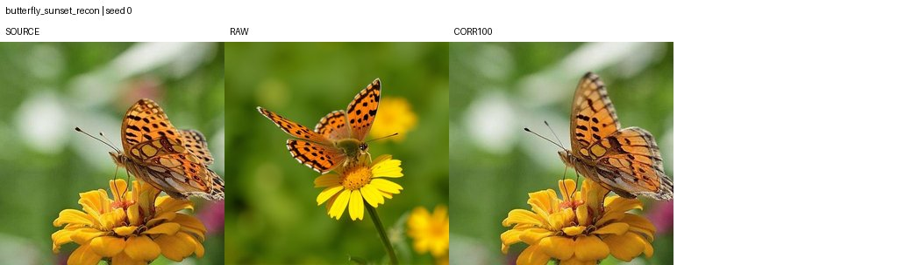

**butterfly_sunset_s0**

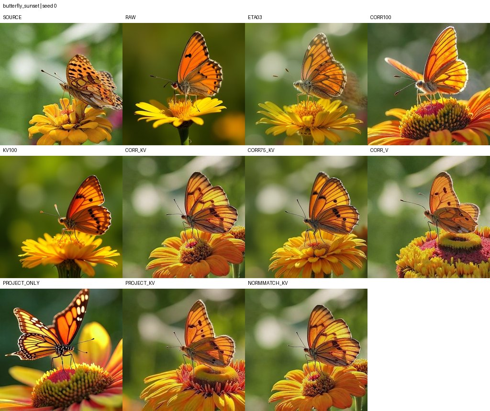

**butterfly_sunset_s17**

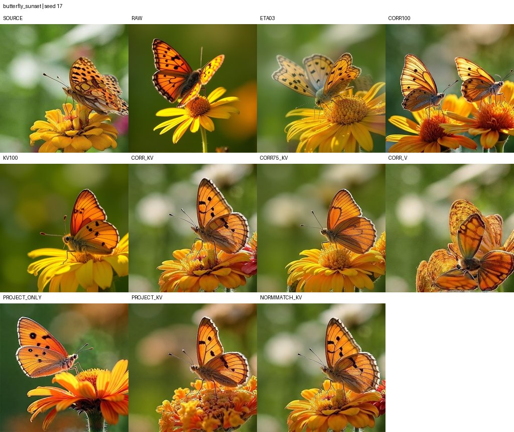

**cup_night_recon_s10**

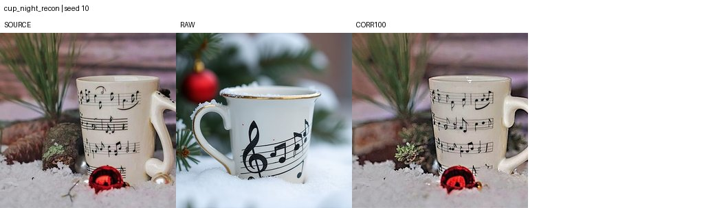

**cup_night_s10**

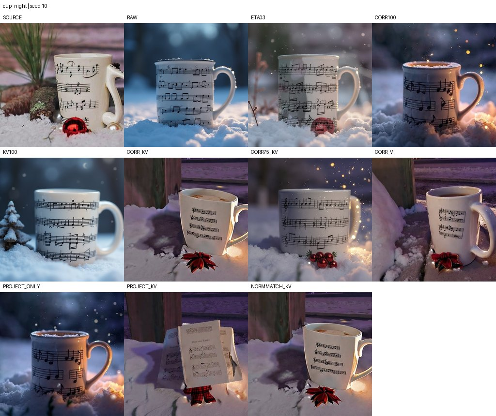

**cup_night_s17**

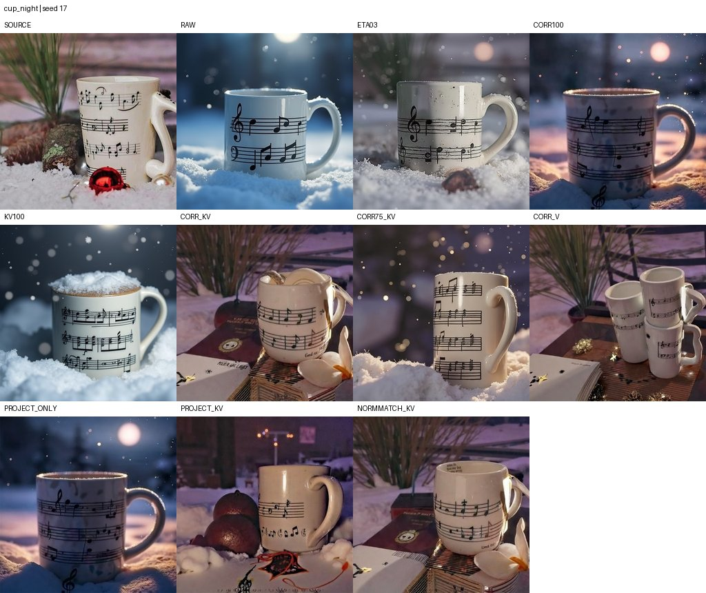

**dog_rain_s0**

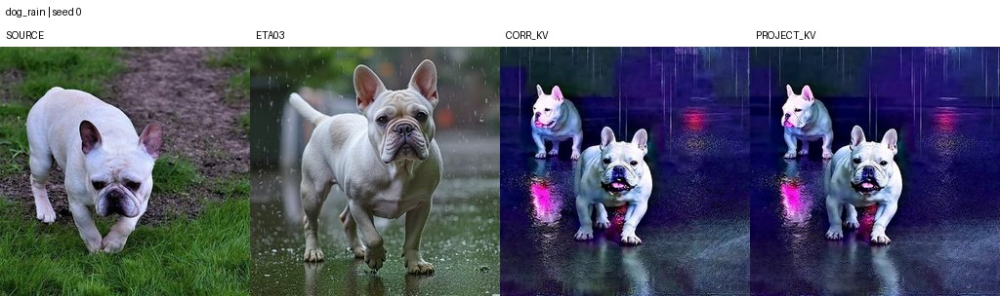

**dog_rain_s17**

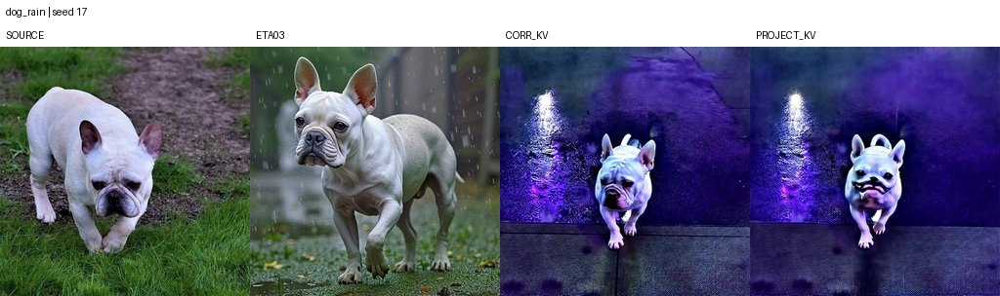

**dog_snow_s0**

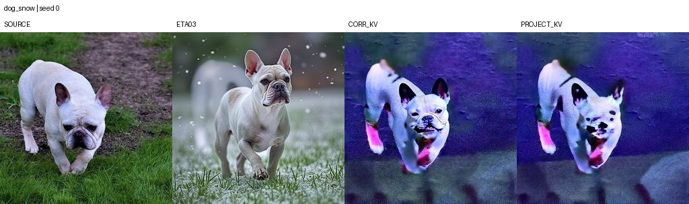

**dog_snow_s17**

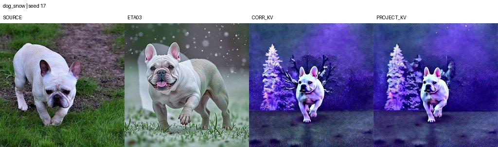

**printed_shirt_studio_recon_s0**

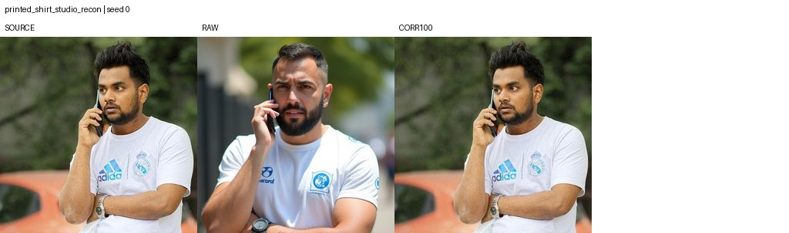

**printed_shirt_studio_s0**

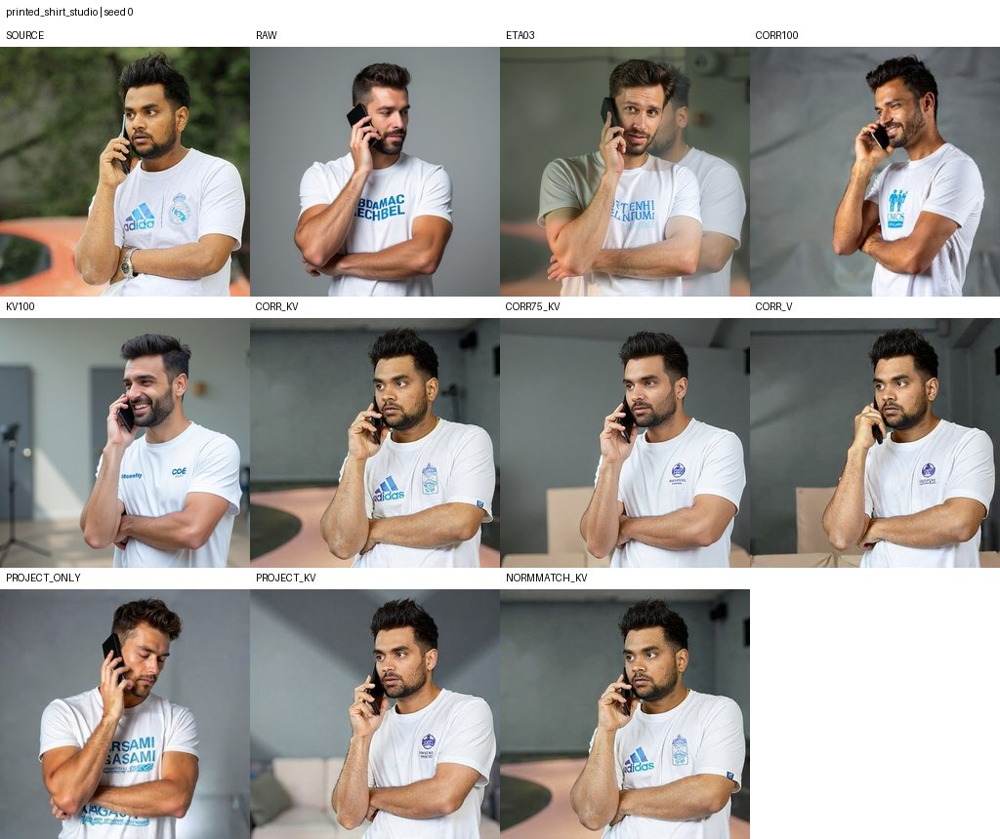

**printed_shirt_studio_s17**

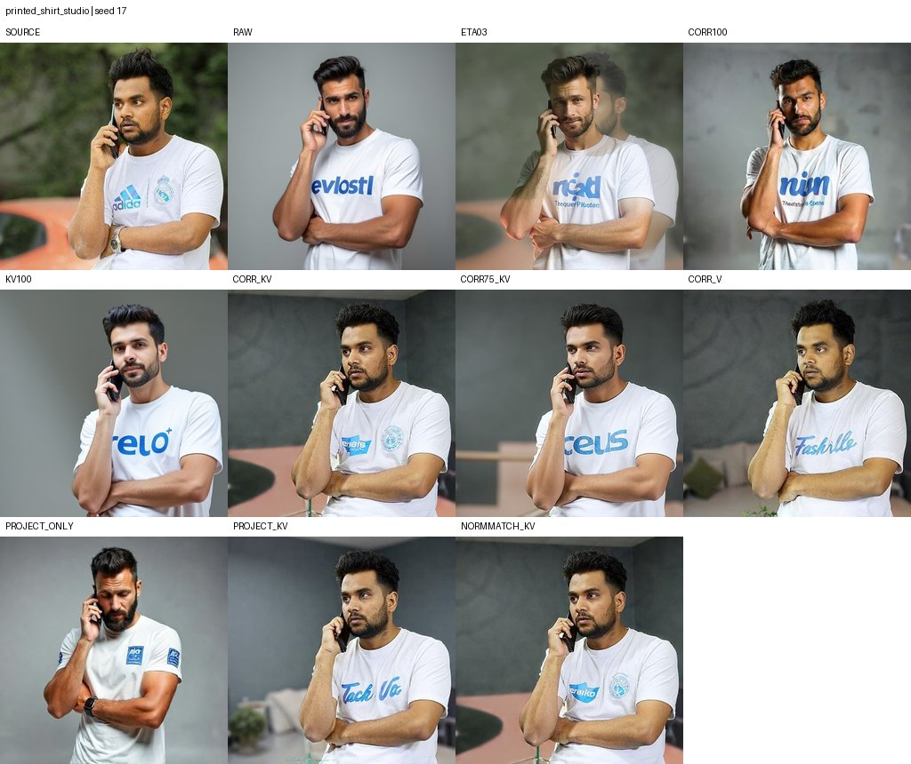

**rug_floor_s0**

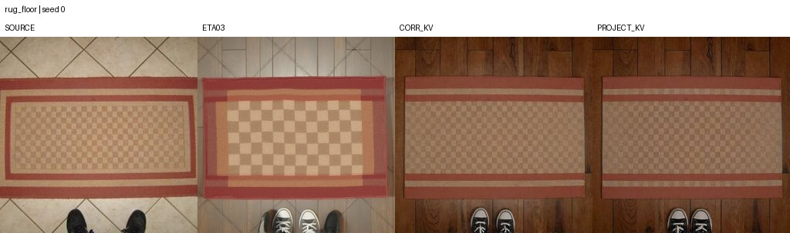

**rug_floor_s17**

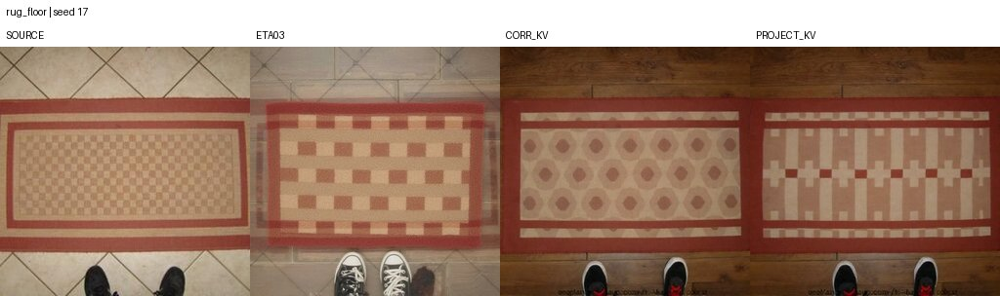

**shirt_studio_s0**

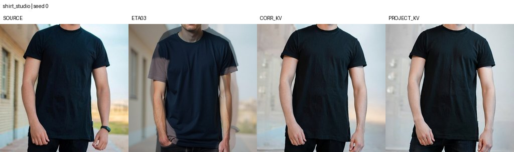

**shirt_studio_s17**

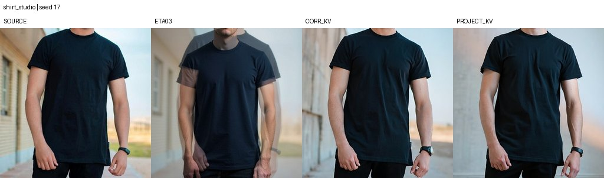

</details>

### R72 完整任务—臂均值

| 任务 | 臂 | n | MAE | 物体 MAE | 背景 MAE | NCC fixed | NCC shift6 |
|---|---|---:|---:|---:|---:|---:|---:|
| cup_night | C50 | 2 | 0.157759 | 0.183611 | 0.147831 | 0.236830 | 0.245833 |
| cup_night | C_EARLY | 2 | 0.177247 | 0.212676 | 0.163641 | 0.430651 | 0.431462 |
| cup_night | C_LATE | 2 | 0.180334 | 0.198545 | 0.173340 | 0.215420 | 0.227746 |
| cup_night | G50 | 2 | 0.218206 | 0.260235 | 0.202065 | 0.249863 | 0.249863 |
| cup_night | G_FADE | 2 | 0.213033 | 0.266033 | 0.192679 | 0.235695 | 0.247975 |
| cup_night | G_MATCH | 2 | 0.205679 | 0.248746 | 0.189140 | 0.264902 | 0.280398 |
| printed_shirt_studio | C50 | 2 | 0.140740 | 0.140804 | 0.132514 | 0.286060 | 0.291975 |
| printed_shirt_studio | C_EARLY | 2 | 0.084174 | 0.084163 | 0.085496 | 0.427324 | 0.430557 |
| printed_shirt_studio | C_LATE | 2 | 0.189749 | 0.189742 | 0.190594 | 0.212708 | 0.224544 |
| printed_shirt_studio | G50 | 2 | 0.164911 | 0.165052 | 0.147081 | 0.399680 | 0.407447 |
| printed_shirt_studio | G_FADE | 2 | 0.117828 | 0.117980 | 0.098493 | 0.321748 | 0.323524 |
| printed_shirt_studio | G_MATCH | 2 | 0.151128 | 0.151237 | 0.137300 | 0.400760 | 0.400760 |
| rug_floor | RAW | 2 | 0.223036 | 0.169682 | 0.311228 | 0.209693 | 0.220675 |
| rug_floor | C50 | 2 | 0.165865 | 0.119215 | 0.242977 | 0.164270 | 0.190843 |
| rug_floor | C_EARLY | 2 | 0.194635 | 0.093510 | 0.361793 | 0.489623 | 0.490491 |
| rug_floor | C_LATE | 2 | 0.132847 | 0.136880 | 0.126179 | 0.164193 | 0.177580 |
| rug_floor | G50 | 2 | 0.213769 | 0.086010 | 0.424952 | 0.250852 | 0.250852 |
| rug_floor | G_FADE | 2 | 0.204729 | 0.088541 | 0.396787 | 0.442616 | 0.442616 |
| rug_floor | G_MATCH | 2 | 0.198798 | 0.070334 | 0.411147 | 0.248842 | 0.249354 |
| dog_rain | RAW | 2 | 0.235680 | 0.302222 | 0.215269 | 0.136563 | 0.189713 |
| dog_rain | C50 | 2 | 0.120690 | 0.188764 | 0.099810 | 0.634412 | 0.674248 |
| dog_rain | C_EARLY | 2 | 0.191932 | 0.316278 | 0.153790 | 0.599832 | 0.604122 |
| dog_rain | C_LATE | 2 | 0.148686 | 0.198951 | 0.133268 | 0.546281 | 0.622615 |
| dog_rain | G50 | 2 | 0.193816 | 0.325812 | 0.153328 | 0.494586 | 0.496553 |
| dog_rain | G_FADE | 2 | 0.199937 | 0.349852 | 0.153953 | 0.476374 | 0.476681 |
| dog_rain | G_MATCH | 2 | 0.180082 | 0.286745 | 0.147365 | 0.661637 | 0.666988 |
| dog_snow | RAW | 2 | 0.420339 | 0.282651 | 0.462572 | -0.206454 | -0.156734 |
| dog_snow | C_EARLY | 2 | 0.172367 | 0.242635 | 0.150814 | 0.590960 | 0.597233 |
| dog_snow | G50 | 2 | 0.337150 | 0.266995 | 0.358669 | 0.108277 | 0.120677 |
| dog_snow | G_FADE | 2 | 0.179867 | 0.283526 | 0.148072 | 0.476429 | 0.476429 |

<details><summary>R72 全部对比图（展开）</summary>


**cup_night_s10**

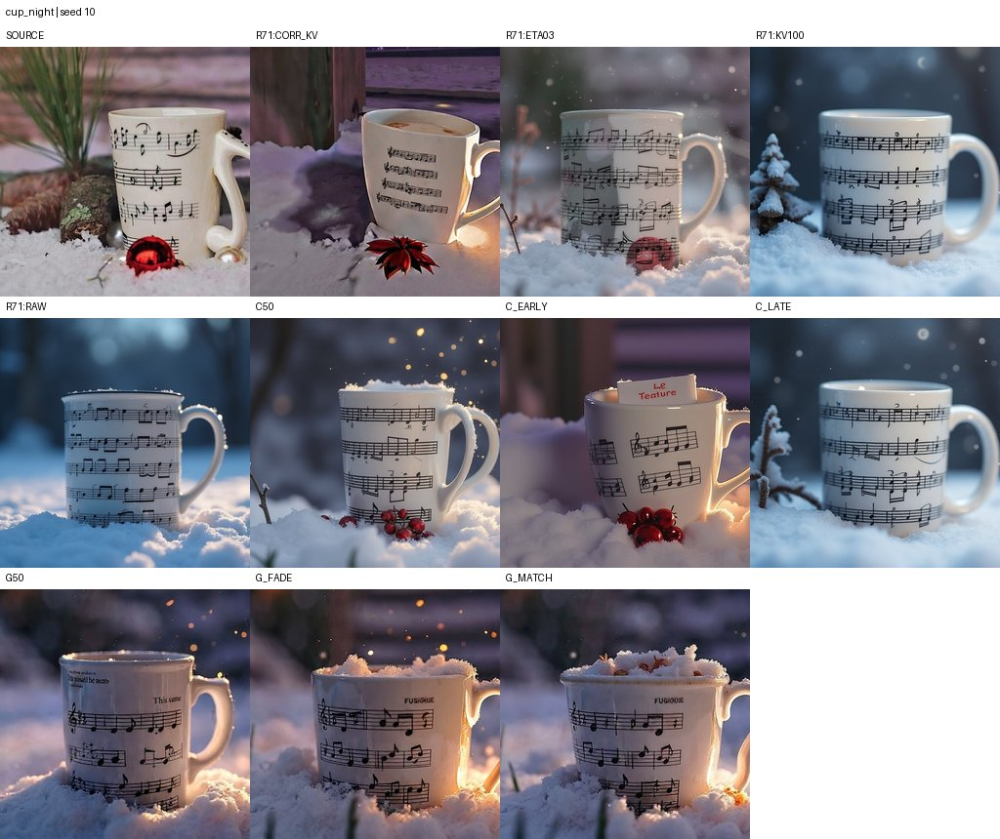

**cup_night_s17**

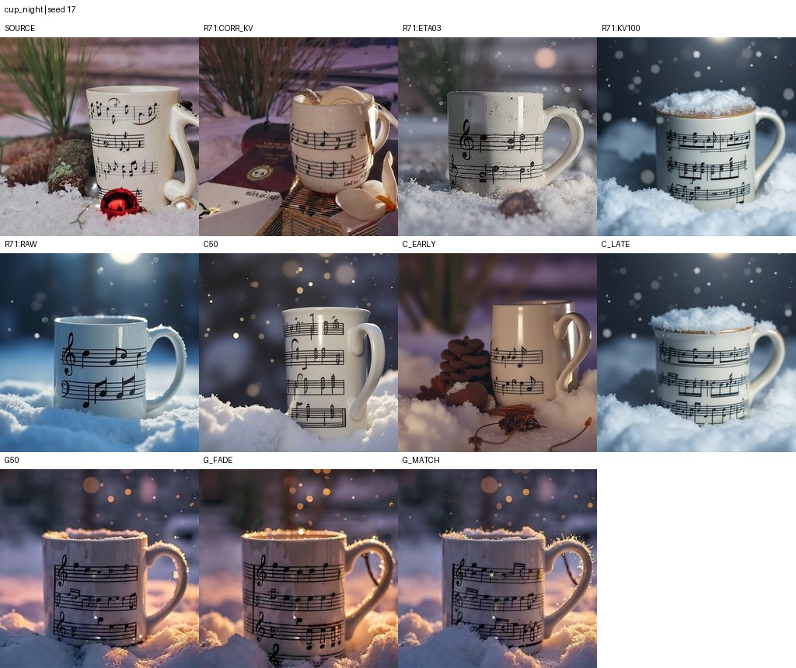

**dog_rain_s0**

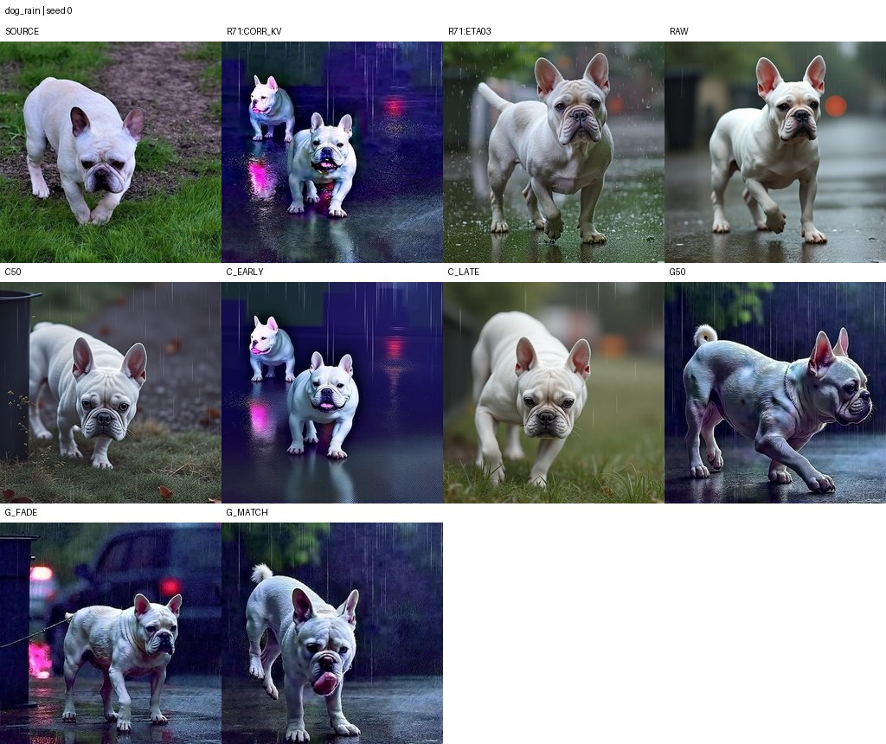

**dog_rain_s17**

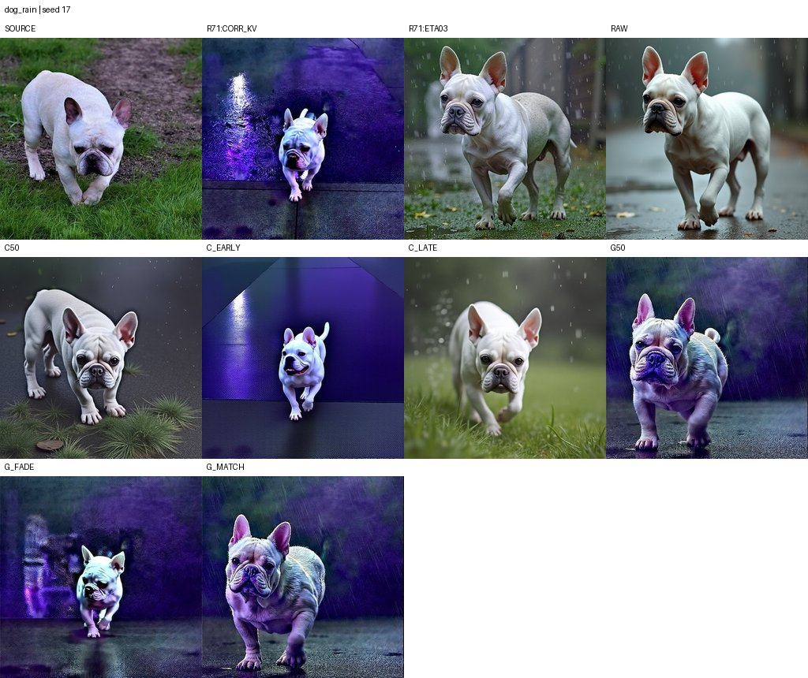

**dog_snow_s0**

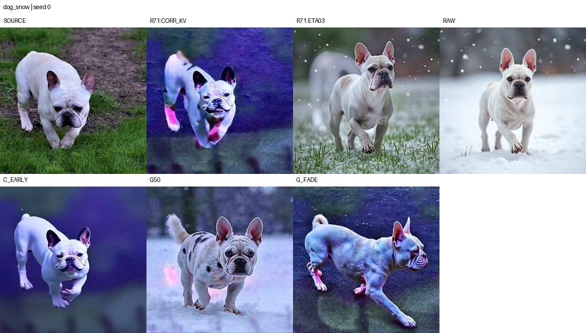

**dog_snow_s17**

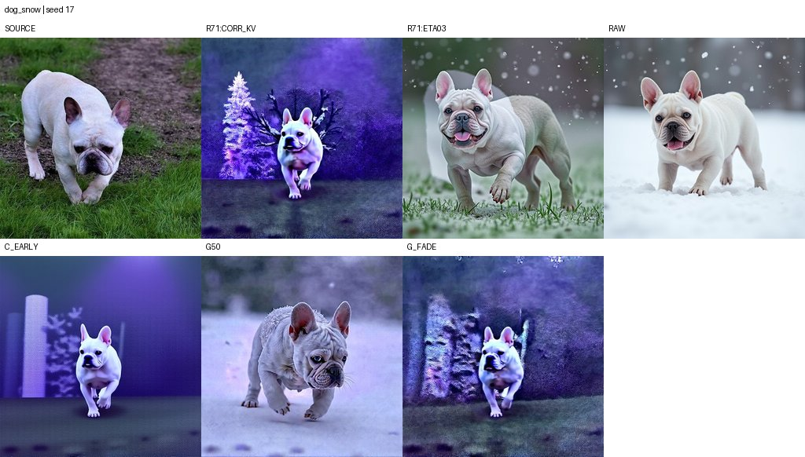

**printed_shirt_studio_s0**

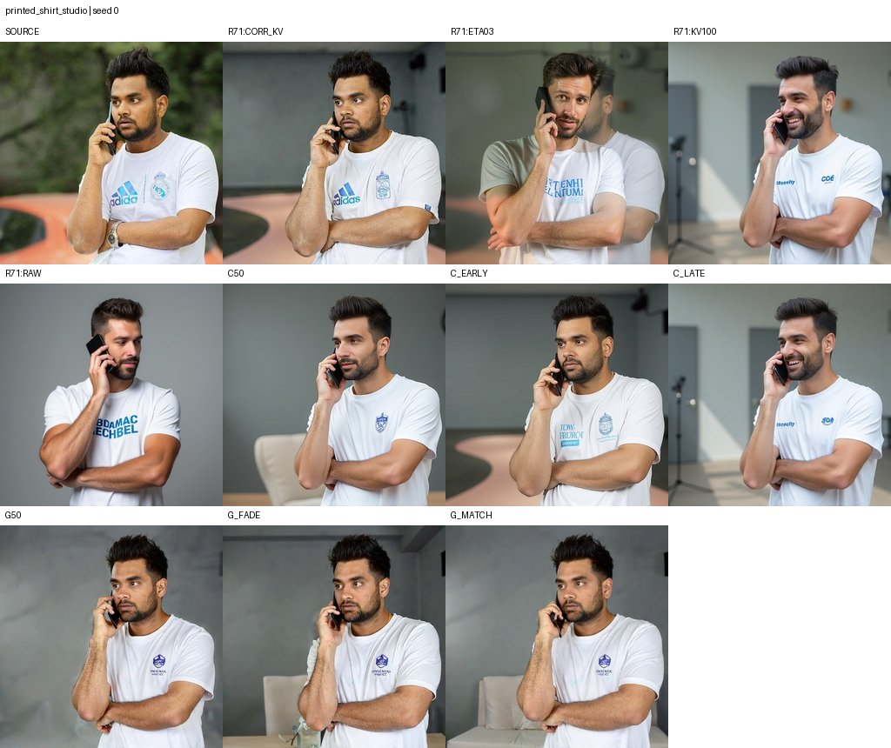

**printed_shirt_studio_s17**

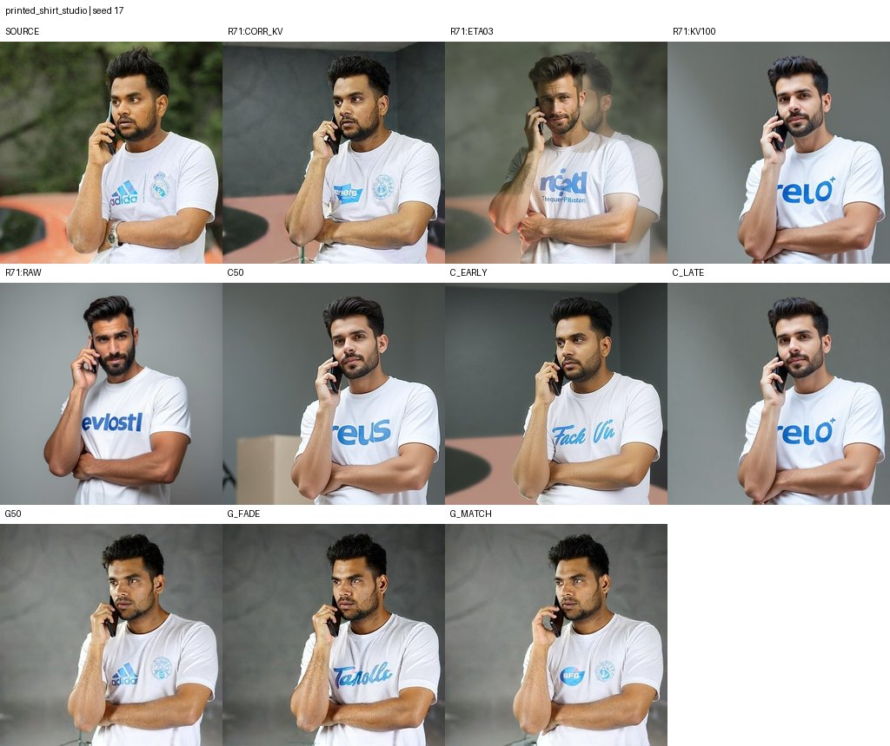

**rug_floor_s0**

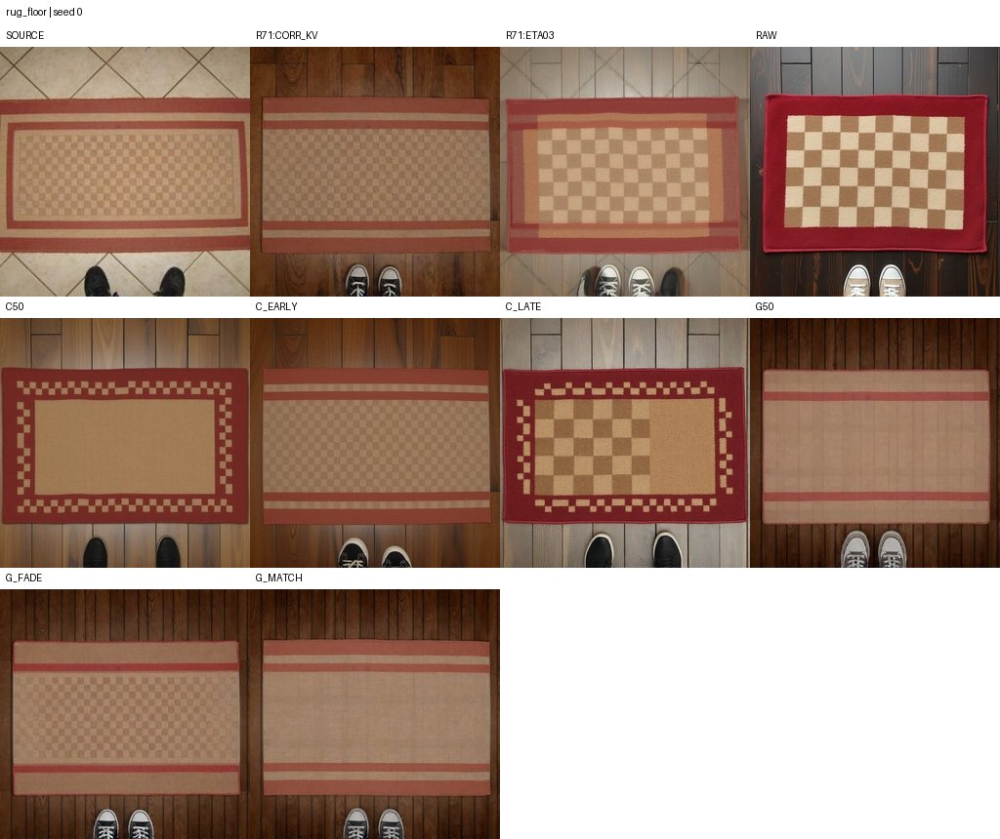

**rug_floor_s17**

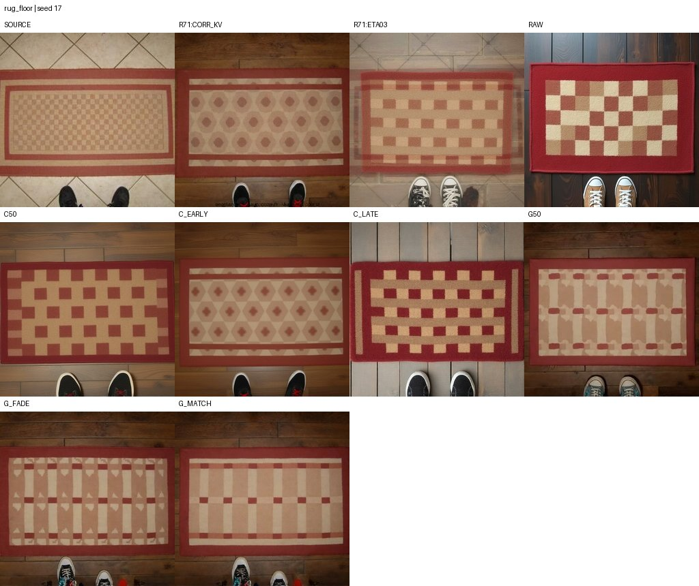

</details>

## 9. 论文结构：对应用户提供的模板

模板源于 `E:/Conference_Manuscript_Writing_Template_EN_Source`，已一并归档到 `paper_template/`。其 `main.tex` 使用 `spie` 单栏类，README 将它定义为约 8 页英文写作脚手架。最终投递时按目标会议当届官方要求调整排版；目前按其五节结构组织内容。

| 模板位置 | 本文建议内容 | 已有材料 |
|---|---|---|
| Abstract | 问题、残差+记忆、预算定义、实测时间分配结果、任务差异 | 第1/3/4/7节与数据表 |
| INTRODUCTION AND RELATED WORK | 特定纹理保持难点；重建、记忆、预算三个层次；最接近工作 | 第2节与相关工作附录 |
| PROPOSED APPROACH | 反演、控制速度、残差、文本质量保留的KV读取、预算调度 | 第3/4节与核心代码 |
| PROTOCOL AND MEASUREMENTS | 数据单位、提示词、seed、预算、NFE、指标、评审规则 | 第5/6节与实际plan |
| RESULTS AND INTERPRETATION | 重建、组件、时间预算、逐图失败与成本 | 本文自动汇总表与图册 |
| CONCLUSION | 当前发现、适用实例、方法代价、下一步直接行动 | 第1/10节 |

### 9.1 建议图表

1. **图1 方法图**：反演参考路径；源分支提供 `p−u_s` 与 K/V；目标分支保留文本贡献；λ 调度；输出。标注源分支额外前向。
2. **图2 调度与预算图**：每组 `λ_i`、`RMS(c_i)`、累计 B；展示 R72 系数预算与 R73 残差预算的区别。
3. **图3 配对定性对比**：杯子两 seed、印花两 seed，包含源、ETA03、CORR_KV、C50、R73早/晚。保留文字重画和多物体案例。
4. **图4 任务边界**：地毯与狗，展示木地板编辑、纹理消失、草地保留、紫偏等具体失效。
5. **表1 主开发集表**（`primary.tex`）：R71 七任务的数值与最终补齐的联合评分。
6. **表2 时间预算表**（`controls.tex`）：R73 八对输入的同预算结果；明确这是开发集控制实验。
7. **表3 组件表**（`ablation.tex`）：RAW/CORR100/KV100/CORR_KV/V-only/投影/范数匹配，按共同三任务统计。
8. **表4 成本与重建**：56/63/84独立NFE及三个重建诊断。

`confirm.tex` 对应独立确认集。当前数据经过多轮方案选择，写作时把这个位置用于明确列出的后续独立验证，或将其合并为成本表，避免把复用种子包装成新测试集。

### 9.2 英文摘要草稿

Preserving instance-specific patterns during text-guided rectified-flow editing requires controlling both source information and the timing of its influence. We study a training-free framework combining source-trajectory residual transfer with source key–value retrieval while retaining the target text contribution and native image attention mass. We introduce a residual-norm-weighted budget to compare early, constant, and late correction schedules at equal cumulative correction magnitude. The archived study contains 166 generated outputs across reconstruction, component, and scheduling experiments. In the final four-task, eight-pair comparison, early, constant, and late correction obtain mean translation-compensated pattern correlations of 0.3783, 0.3507, and 0.3343, respectively. Visual analysis reveals complementary behavior: late correction yields clearer nighttime illumination in the mug examples, whereas stronger source correction better retains some clothing details while introducing scene or appearance artifacts. These results provide a controlled account of correction timing and source-memory effects, together with explicit computational costs and failure cases.

摘要当前准确对应已读数据。完成联合评分和外部对照后，将其加入摘要中的主结果句，并用最终具体数字更新。

## 10. 交接后的优先行动

### 10.1 当前就能做的写作工作

完成问题定义、方法公式、实现描述、重建诊断、R73预算控制表、成本表、失败案例和相关工作比较。按本文图册选图，同时保留全量图册链接；固定本文中的计数与指标定义。

### 10.2 最有价值的两项补充

1. **统一人工复核当前图片。** 优先 R73 的56张比较输出，再补 R71主要臂。按现有 `edit_rubric` 判断编辑、主体、图案、伪影。至少让第二位作者独立判断关键差异，分歧逐图解决。该工作不需要生成新图片。
2. **选择一个机制最接近的方法做同输入比较。** 优先 DirectEdit 或 RF-Edit，锁定相同源图、编辑文本与输出尺寸，同时报告其推荐设置及真实 NFE。η 调参是本方法内部强基线，外部方法表单独列。已发表论文中的数字只用于介绍其研究背景，不拼入当前实验排名。

用户已将 R73 定为最后一轮。本次没有继续发起这些实验；它们是交给下一位研究者的投稿定稿任务。若只写当前规模的稿件，定位为小规模受控机制研究，完整报告联合评分与实例差异。

### 10.3 算法改进的具体入口

- **缓存源条件分支**：在同一反演轨迹、同源提示词、同guidance、同eta下，源速度及源KV可以跨目标文本/参数臂复用。先缓存编辑源分支，不用不同条件的反演速度替代。收益主要来自摊销；单输入首次运行仍付源分支成本。
- **把语义编辑目标加入选择依据**：杯子需要夜景达成、印花需要特定logo、狗需要湿路面。使用联合评分选择候选参数；保持统一开发/测试分离。
- **针对图案重画改评价与读出区域**：源mask可以作为后续消融变量，先区分它对源记忆可读区域与目标写入区域的作用。当前论文代码保持无生成mask，避免混淆已完成结果。
- **结束无效旋钮扩展**：本轮时间调度已经给出数据。优先把现有数字与语义判断连起来，再考虑新架构。

## 11. 实现、复现与仓库路径

```text
README.md                         本完整论文骨架/分析/代码说明
experiments/R71_TraceMemory/       与R71运行manifest匹配的代码、plan、输入
experiments/R72_TimeBudget/        与R72运行manifest匹配的代码、plan、复用参照
experiments/R73_ResidualBudget/    与R73运行manifest匹配的代码、plan、预算profile
results/R71/                      原始结果ZIP逐文件展开
results/R72/                      原始结果ZIP逐文件展开
results/R73/                      原始结果ZIP逐文件展开；全部8张对比图
paper_template/                   原英文模板的TeX与class文件
tools/summarize.py                 从原始CSV重算本文核心数字，纯CPU
```

| 文件/函数 | 作用 |
|---|---|
| `rf_kv.py::invert` | γ控制反演与sigma checkpoint |
| `engine.py::execute` | 源/目标前向、残差、调度、更新、NFE与逐步日志 |
| `attention.py::Processor.content_memory` | 保留目标文本贡献的源KV读取 |
| `attention.py::AttentionMemory` | 单流块hook、capture/apply/off生命周期 |
| `controls.py::load_controls` | 全图/局部控制量打包；本轮全图 |
| `mint_backend.py` | FLUX编码、时间表、网络场、解码 |
| `model_loader.py` | 固定依赖/模型revision与离线加载 |
| `runner.py` | jobs执行、反演缓存、逐图保存与暂停 |
| `reporting.py` | CSV、NCC、对比图、结果ZIP与指纹 |
| `review.py` | 导入离线人工评分并保留图像hash |
| `plan.json` | 全参数、提示词、ROI、seed、预算profile与预注册判据 |

源码快照已逐项对应结果manifest：R71 11个代码文件、R72 12个、R73 12个，全部一致。整理过程没有修改算法源码，也没有重新运行GPU任务。

### 11.1 查看与复算

```bash
git clone https://github.com/leiyurun3-sudo/rf-trace-memory.git
cd rf-trace-memory
python tools/summarize.py
```

该命令只读取CSV并打印统计。图片可直接查看 `results/R73/sheets/`；各轮 `index.html` 是原始图册。结果ZIP保持原始字节保存于GitHub Release。

### 11.2 如需复现生成

原运行脚本期待实验目录的父级有 `.venv/bin/python`，模型缓存为 `/root/autodl-tmp/hf_cache/hub/models--black-forest-labs--FLUX.1-dev/snapshots/<revision>` 或 `HF_HOME/hub`。将需要的实验目录放入原 `MINT_Flow_Jupyter_Ready` 项目再运行。**以下为重跑命令说明，本次交接没有执行它。**

```bash
cd /root/autodl-tmp/MINT_Flow_Jupyter_Ready
bash R73_ResidualBudget/start.sh
```

`start.sh` 后台启动并同时跟随日志，Ctrl+C退出日志查看，生成仍继续。每个输出立即保存384px预览、原生图案裁片、record、steps、CSV和结果包；`touch R73_ResidualBudget/PAUSE` 在当前图完成后暂停。现有结果恢复需保留与运行代码/plan指纹一致的 `results/` 目录，避免把归档与不同配置混写。

### 11.3 数据与权重

源图、评价mask、输出预览与实验代码已归档。FLUX权重及Python环境不随仓库上传。仓库保持私有，便于研究交接；正式公开时逐项核对数据来源、模型许可及原代码许可，并补齐署名。没有为未知来源资产擅自添加开源许可证。

## 12. 给 Gemini / 下一位论文作者的审阅任务

请直接围绕本文和原图给出修改意见：

1. 检查更新方程与实际 `engine.py`，尤其sigma方向、源/目标前向、校正项定义和注意力质量保留公式。
2. 对8张R73对比图，按任务目标分别判断编辑、主体、图案和明显伪影；报告具体job与理由。
3. 评价“残差范数预算控制”相对 DirectEdit/RF-Edit/FlowEdit 的新增价值，区分既有机制与本稿实验推进。
4. 判断拟写主结论最适合“条件性图案保持方法”还是“预算与时间分配的机制研究”，给出对应标题和摘要修订。
5. 指出哪一个外部方法最值得优先比较，保持同输入、同目标与透明成本。
6. 核对所有表格样本量：166输出=160编辑+6重建，R73=16新+40复用；不同对象、种子、重复引用分别计数。

最终交接目标是让下一位作者能够直接写方法、实验和讨论，并沿每项数字找到原始输出。

## 13. 相关工作与贡献定位

本研究关注流匹配图像编辑中的轨迹跟随与内容保持：源轨迹提供的离散运动约束如何进入目标动力学，源图注意力如何参与内容迁移，以及校正作用的时间分配如何影响结构与外观。论文定位为“源轨迹校正与注意力迁移的预算化机制分析”。具体推进在于显式描述校正量、统一核算累计校正预算，并结合结构指标与可见缺陷解释调度差异；反演与KV组合本身不作为贡献。

方法定义

令源轨迹离散速度 p_i=(r_next-r)/h，源场速度为 u_s，校正量 c=p_i-u_s，目标更新为 z_next=z+h*(u_t+lambda*c)。累计预算 B=sum_i h_i*lambda_i*RMS(c_i)，用于比较不同调度实际施加的校正量。源图KV取自同一步source field前向；注意力保留target text contribution，并将target native image attention mass乘以softmax(Q_target K_source^T)V_source。此处区分源运动校正与源内容迁移两个作用位置，使机制比较落到可核对的更新式与注意力运算。

相关工作比较

| 工作与原文位置 | 已有机制 | 本研究的比较落点 |
|---|---|---|
| DirectEdit [1] §3.2，式9–10 | 重建先加入记录的latent increment，再在shifted latent评估velocity，以实现逐步对齐 | 比较离散轨迹与场速度的对齐方式，以及c如何进入目标更新 |
| RF-Edit [2] §3.2–3.3，式14 | 高阶Taylor求解；FLUX single blocks采用target Q/K与source V | 本方法迁移source K/V，并显式保留目标文本贡献及原生图像注意力总质量 |
| FireFlow [3] Method | 复用前一步midpoint velocity；首个去噪步的全部自注意力使用source V | 对照速度复用与轨迹残差校正，以及source V注入与source K/V迁移 |
| FlowEdit [4] §4–5 | 通过源、目标场之差直接运输分布，采用inversion-free编辑 | 比较源目标场差与p_i-u_s的不同定义及作用路径 |
| OTRF [5] Algorithm 1 | 在RF控制场追加沿(z_target-z)/(T-t)的裁剪OT方向并调度，x_target=x_source | 比较指向指定状态的控制方向与轨迹速度残差；统一讨论调度及累计作用量 |
| DirectInversion [6] | 通过分离source/target branch处理残差 | 残差与分支分离已有先例，新增价值需落实到当前动力学、注意力形式和诊断证据 |

这些工作分别推进了重建对齐、数值求解、源特征迁移和直接运输。本研究将比较集中到三个可解释因素：校正方向来自哪里、源内容通过什么注意力运算进入目标、相同预算如何分配到不同时间段。预算公平是机制诊断的关键：应同时报告实际B与结果，避免把累计作用量变化混入时机差异。DirectEdit的比较范围采用已核读的重建对齐部分。

三条新增价值候选及对应证据

1. 将源轨迹偏差转成可计量的目标校正。已核对的更新式明确了p_i、u_s和c的关系，B提供跨调度核算依据。候选价值在于建立可复核的校正强度与时间分配分析，而非以残差概念命名创新。性能收益需结合现有对照与实际预算评估。

2. 在保留目标注意力分配的同时迁移源图内容。已核对实现保留目标文本贡献和原生图像注意力总质量，再用源K/V重分配图像内容；这一运算区别于RF-Edit的target Q/K+source V。机制差异有明确依据，视觉收益需由已有消融和语义评分支撑。

3. 揭示调度收益与外观缺陷的分离。R73覆盖4任务、2seed，新增16份输出、复用40份对照；early/const/late的shiftNCC分别为0.3783/0.3507/0.3343。early在本轮结构指标上更高，地毯纹理重画与狗的紫偏仍然存在，因此其收益具有任务与指标依赖。R71–R73累计166份新输出，包括160份编辑与6份重建，覆盖6个source objects、7个编辑任务；语义评分全部pending。

两条优先行动

1. 本交接已汇总实际预算、步数、seed和对照来源。R73的16张新结果全部达到预算匹配，最大相对误差为2.58e-8；据此撰写时间分配分析。

2. 完成现有结果的语义与外观评分，重点核对纹理重画、紫偏和编辑指令完成度，并与shiftNCC并列呈现。收尾优先补齐这两项证据，沿用现有输出与对照，不新增跑图矩阵。

原文索引
[1] DirectEdit：https://arxiv.org/html/2605.02417v1
[2] RF-Edit：https://arxiv.org/html/2411.04746v3
[3] FireFlow：https://arxiv.org/html/2412.07517v1
[4] FlowEdit：https://arxiv.org/html/2412.08629v2
[5] OTRF：https://arxiv.org/html/2508.02363v2
[6] DirectInversion：https://arxiv.org/abs/2310.01506

RF-Inversion 控制器原文：[RF-Inversion paper](https://rf-inversion.github.io/data/rf-inversion.pdf)。相关工作的已发表结果用于方法背景；当前主表的数值均来自本仓库同一实验协议。


## 14. 实际实现代码与来源追踪

以下直接收录本次冻结的 R73 核心源文件，便于 Gemini 在一个 Markdown 内核对公式和实现。完整依赖、注意力处理器和评估代码均保存在 `experiments/R73_ResidualBudget/`。

### 14.1 `rf_kv.py`

```python
"""Unchanged R53 source inversion and sigma checkpoint convention."""
import torch

@torch.inference_mode()
def invert(b,y,ids,empty,seed,j,tick):
    s=b.schedule(y.shape[1]);asc=s.flip(0);z=y.to(b.device).float().clone()
    noise=torch.randn(z.shape,generator=torch.Generator(device=b.device).manual_seed(seed),device=b.device)
    states=[z.cpu().clone()];logs=[];sub=int(j['inv_substeps']);count=b.nfe
    for i in range(len(asc)-1):
        lo,hi=float(asc[i]),float(asc[i+1]);h=(hi-lo)/sub
        for k in range(sub):
            t=lo+k*h
            if not 0<=t<1:raise ValueError('Invalid inversion model time')
            v=b.field(z,t,empty,ids,0.)
            z=z+h*((1-j['gamma'])*v+j['gamma']*(noise-z)/(1-t))
            if not torch.isfinite(z).all():raise FloatingPointError('Nonfinite inversion')
            logs.append(dict(model_time=t,h=h,node=i,substep=k,rms=float(z.square().mean().sqrt())))
            tick(i*sub+k+1,(len(asc)-1)*sub)
        states.append(z.cpu().clone())
    # Coarse checkpoints exactly match descending generation nodes, even for sub=2.
    return list(reversed(states)),dict(seed=seed,gamma=j['gamma'],sigmas=s.tolist(),state_sigmas=s.tolist(),logs=logs,nfe=b.nfe-count,conditioning='empty text, guidance embedding 0',substeps=sub)

```

### 14.1 `engine.py`

```python
"""RF editing with reference residual transfer and token-wise conflict projection."""
import torch
from attention import AttentionMemory


def rms(x):
    return float(x.float().square().mean().sqrt())


def project_correction(correction, direction):
    """Project c onto {v: dot(v,d)>=0}, independently per packed image token."""
    dot = (correction * direction).sum(-1, keepdim=True)
    norm2 = direction.square().sum(-1, keepdim=True)
    coefficient = torch.where(norm2 > 1e-12, dot.clamp_max(0) / norm2.clamp_min(1e-12), 0.)
    return correction - coefficient * direction, (dot < 0) & (norm2 > 1e-12)


@torch.inference_mode()
def execute(b, y, ids, src, tgt, controls, job, trajectory, tick, alignment):
    sigmas = b.schedule(y.shape[1])
    hs = [float(sigmas[k] - sigmas[k + 1]) for k in range(len(sigmas) - 1)]
    span = float(sigmas[0] - sigmas[-1])
    early = [(float(sigmas[k] + sigmas[k + 1]) / 2 - float(sigmas[-1])) / span for k in range(len(hs))]
    schedule = job.get('corr_schedule', 'constant')
    if schedule in ('budget_early', 'budget_late'):
        weights = job['corr_weights']
        if len(weights) != len(hs) or any(abs(a-b) > 1e-7 for a,b in zip(hs,job['budget_h'])):
            raise ValueError('R73 residual profile uses a different sigma grid')
    else:
        weights = {'constant': [1.] * len(hs), 'early': early, 'late': [1. - x for x in early]}[schedule]
    first, end = int(job['src_start']), min(int(job['src_steps']), len(hs))
    fade = [1. - (1. - job.get('gate_end', .3)) * (k - first) / max(1, end - first - 1) for k in range(first, end)]
    matched = sum(hs[k] * fade[k - first] for k in range(first, end)) / sum(hs[first:end])
    gate_kind = job.get('gate_schedule', 'constant')
    gate_values = [0.] * len(hs)
    for k in range(first, end):
        factor = {'constant': 1., 'fade': fade[k - first], 'fade_matched': matched}[gate_kind]
        gate_values[k] = float(job['query_write_weight']) * factor
    z = trajectory[0].to(b.device).float().clone()
    anchor = y.to(b.device).float()
    mask, allowed = (controls[k] for k in ('mask', 'allowed'))
    lam = controls['calibration'] * float(job['corr_lambda'])
    policy, mode = job['corr_policy'], job['mode']
    memory = None if mode == 'off' else AttentionMemory(b.pipe.transformer, z.shape[1], controls, job, alignment)
    logs, before, source_nfe, target_nfe = [], b.nfe, 0, 0
    try:
        for i in range(len(sigmas) - 1):
            sigma = float(sigmas[i])
            h = float(sigmas[i] - sigmas[i + 1])
            ref = trajectory[i].to(b.device).float()
            next_ref = trajectory[i + 1].to(b.device).float()
            path = (next_ref - ref) / h
            eta = job['eta'] * min(1., max(0., (sigma - .2) / .25))
            active = memory is not None and job['src_start'] <= i < job['src_steps']
            if memory is not None:
                memory.off()
            correction = torch.zeros_like(z)
            source_velocity = None
            if job['corr_lambda'] > 0 or active:
                if active:
                    memory.capture()
                source_field = b.field(ref, sigma, src, ids, job['guidance'])
                source_nfe += 1
                source_velocity = -(1 - eta) * source_field + eta * (anchor - ref) / sigma
                correction = path - source_velocity
            if active:
                memory.apply(i, deviation=(z - ref).square().mean(-1).sqrt()[:, None, :, None], gate=gate_values[i])
            target_field = b.field(z, sigma, tgt, ids, job['guidance'])
            target_nfe += 1
            changes = list(memory.actual) if active else []
            if memory is not None:
                memory.off()
            target_velocity = -(1 - eta) * target_field + eta * (anchor - z) / sigma
            applied = correction
            conflict_fraction, retained_norm, removed_rms = None, None, None
            if job['corr_lambda'] > 0:
                # Cross-state velocity difference; includes target memory when active.
                # It is an editing-direction proxy, not a semantic gradient.
                direction = target_velocity - source_velocity
                projected, conflict = project_correction(correction, direction)
                norm = correction.square().sum(dim=(1, 2), keepdim=True).sqrt()
                projected_norm = projected.square().sum(dim=(1, 2), keepdim=True).sqrt()
                ratio = torch.where(norm > 1e-12, projected_norm / norm.clamp_min(1e-12), torch.ones_like(norm))
                if policy == 'conflict':
                    applied = projected
                elif policy == 'norm_matched':
                    # Same instantaneous residual norm as the hypothetical projection
                    # at THIS arm's state, rather than a replay of another trajectory.
                    applied = ratio * correction
                elif policy != 'constant':
                    raise ValueError('Unknown correction policy: ' + policy)
                conflict_fraction = float(conflict.float().mean())
                retained_norm = float(ratio.mean())
                removed_rms = rms(correction - applied)
            step_lam = lam * weights[i]
            residual = target_velocity + step_lam * applied - path
            proposal = z + h * path + h * mask * residual
            z = torch.where(allowed > 0, proposal, next_ref)
            if not bool(torch.isfinite(z).all()):
                raise FloatingPointError('Nonfinite RF state')
            logs.append(dict(step=i + 1, sigma=sigma, h=h, eta=eta,
                             corr_lambda=float(job['corr_lambda']) * weights[i], corr_schedule=schedule, gate_schedule=gate_kind, scheduled_gate=gate_values[i] if active else 0., corr_policy=policy,
                             mode=mode, injection_active=active,
                             source_velocity_rms=None if source_velocity is None else rms(source_velocity),
                             source_path_rms=rms(path), target_velocity_rms=rms(target_velocity),
                             applied_correction_rms=rms(mask * step_lam * applied),
                             correction_removed_rms=removed_rms, conflict_fraction=conflict_fraction,
                             projected_norm_ratio=retained_norm,
                             residual_update_rms=rms(h * mask * residual),
                             source_path_distance=rms(z - next_ref), injection=changes))
            tick(i + 1, len(sigmas) - 1)
    finally:
        if memory is not None:
            memory.close()
    impulse = sum(row['h']*row['applied_correction_rms'] for row in logs)
    budget_error = abs(impulse-job['correction_budget_target'])/job['correction_budget_target']
    return z.cpu(), dict(correction_impulse=impulse, correction_budget_relative_error=budget_error, correction_budget_status='matched' if budget_error <= .01 else 'mismatch', nfe=b.nfe - before, source_nfe=source_nfe, target_nfe=target_nfe,
                         reference=None, correction_budget_h=sum(h*w*float(job['corr_lambda']) for h,w in zip(hs,weights)), gate_budget_h=sum(h*g for h,g in zip(hs,gate_values)), steps=logs)

```

### 14.2 注意力记忆 `content_memory`

```python
    def content_memory(self, q, k, v, nt):
        """Keep native text contribution AND native image mass for each query."""
        o = self.owner
        ks, vs = (x.to(q.device, dtype=q.dtype) for x in o.bank[self.index])
        image_k, image_v = ks, vs
        if o.variant == 'attn_budget':
            image_k = ks if o.job.get('memory_source_k', True) else k[:, :, nt:]
            image_v = vs if o.job.get('memory_source_v', True) else v[:, :, nt:]
        if o.variant == 'aligned_kv_budget':
            strength = float(o.job.get('kv_mix', 0.5))
            image_k = torch.lerp(k[:, :, nt:].float(), ks.float(), strength).to(k.dtype)
            image_v = torch.lerp(v[:, :, nt:].float(), vs.float(), strength).to(v.dtype)
        pairing = o.job.get('memory_pairing', 'paired')
        if pairing == 'v_deranged':
            if not (o.job.get('memory_source_k', True) and o.job.get('memory_source_v', True)):
                raise ValueError('PairBreak requires paired source K and V')
            cache = getattr(self, '_pair_permutations', None)
            if cache is None:
                cache = self._pair_permutations = {}
            n = image_v.shape[2]
            seed = int(o.job['case']) % 2147483647 + int(o.job['seed'])*1009 + self.index*9176
            key = (n, seed, str(image_v.device))
            if key not in cache:
                # Random single cycle: every V slot changes, no K slot changes.
                order = torch.randperm(n, generator=torch.Generator(device='cpu').manual_seed(seed))
                permutation = torch.empty_like(order)
                permutation[order] = order.roll(1)
                cache[key] = permutation.to(image_v.device)
            image_v = image_v.index_select(2, cache[key])
        elif pairing != 'paired':
            raise ValueError('Unknown memory pairing: ' + pairing)
        scale = 1 / math.sqrt(q.shape[-1])
        kt = k.float().transpose(-1, -2)
        chunks, text_mass, image_mass = [], 0., 0.
        concentration=[]
        source_kt=image_k.float().transpose(-1,-2)
        for start in range(0, o.tokens, 128):
            end = min(start + 128, o.tokens)
            qi = q[:, :, nt+start:nt+end]
            native = (qi.float() @ kt * scale).softmax(-1)
            tm = native[..., :nt].sum(-1, keepdim=True)
            im = native[..., nt:].sum(-1, keepdim=True)
            text_output = native[..., :nt].to(v.dtype) @ v[:, :, :nt]
            source_probability=(qi.float() @ source_kt * scale).softmax(-1)
            entropy=-(source_probability*source_probability.clamp_min(1e-12).log()).sum(-1,keepdim=True)
            concentration.append((1-entropy/math.log(o.tokens)).clamp(0,1).mean(dim=1,keepdim=True))
            retrieved = source_probability.to(image_v.dtype) @ image_v
            chunks.append((text_output.float() + im * retrieved.float()).to(v.dtype))
            text_mass += float(tm.sum())
            image_mass += float(im.sum())
        denom = q.shape[0] * q.shape[1] * o.tokens
        self.map_stats = dict(native_text_mass=text_mass / denom,
                              native_image_mass=image_mass / denom,
                              memory_source_k=o.job.get('memory_source_k', True),
                              memory_source_v=o.job.get('memory_source_v', True),
                              preserves_target_text_contribution=True,
                              memory_window=[o.job.get('src_start', 0), o.job['src_steps']])
        c=torch.cat(concentration,dim=2)
        drift=o.pixel_deviation.to(q.device).float()
        median=drift.median(dim=2,keepdim=True).values
        kind=o.job.get('gate_mode','uniform');budget=o.current_budget
        weight=(c+1e-6).square()
        if kind in ('dual','dual_rank','dual_rank_shuffle'):
            weight=weight*torch.exp(-(drift/(median+1e-6)).clamp(max=30))
        if kind=='uniform':self.dynamic_gate=torch.full_like(c,budget)
        elif kind in ('dual_rank','dual_rank_shuffle'):
            # Fixed permutation per layer/seed across timesteps preserves temporal consistency.
            seed=(int(o.job['case']) % 2147483647)+o.job['seed']*1009+self.index*9176
            self.dynamic_gate=ranked_gate(weight,budget,o.job.get('gate_contrast',0.25),
                shuffle_seed=seed if kind=='dual_rank_shuffle' else None)
        else:self.dynamic_gate=balanced_gate(weight,budget)
        centered_c=c-c.mean();centered_d=drift-drift.mean()
        denom_corr=centered_c.square().sum().sqrt()*centered_d.square().sum().sqrt()
        corr=float((centered_c*centered_d).sum()/denom_corr) if float(denom_corr)>1e-12 else None
        self.map_stats.update(gate_mode=kind,gate_mean=float(self.dynamic_gate.mean()),
            gate_std=float(self.dynamic_gate.std(unbiased=False)),
            feature_concentration_mean=float(c.mean()),trajectory_deviation_mean=float(drift.mean()),
            feature_drift_corr=corr,
            gate_budget_error=float((self.dynamic_gate.mean(dim=2)-budget).abs().max()))
        if self.index==o.job.get('gate_probe_block',13) and o.step in o.job.get('gate_probe_steps',[0,3,6]):
            self.map_stats['gate_probe']=dict(step=o.step,block=self.index,
                concentration=c[0,0,:,0].detach().cpu().tolist(),
                drift=drift[0,0,:,0].detach().cpu().tolist(),
                gate=self.dynamic_gate[0,0,:,0].detach().cpu().tolist())
        return torch.cat(chunks, dim=2)
```

### 14.3 等预算调度的可读实现

下式与计划中的 `budget_mu`、`budget_scale`、`corr_weights` 对应；真实运行读取已写入 `plan.json` 的逐步权重。输入 `residual_rms` 是匹配的源轨迹完整校正量 RMS。

```python
def residual_budget_schedules(h, sigma_mid, residual_rms):
    a = [hi * ci for hi, ci in zip(h, residual_rms)]
    mu = sum(ai * qi for ai, qi in zip(a, sigma_mid)) / sum(a)
    scale = 0.5 / max(mu, 1.0 - mu)
    early = [0.5 + scale * (q - mu) for q in sigma_mid]
    late = [0.5 - scale * (q - mu) for q in sigma_mid]
    target_budget = 0.5 * sum(a)
    return early, late, target_budget
```

### 14.4 原始归档的 SHA-256

| 归档 | SHA-256 |

|---|---|

| `R71_TraceMemory_Results.zip` | `de5edcd463b8447552073ebcbc74f85fe33e58499773efb45f0acb51af11b39c` |

| `R72_TimeBudget_Results.zip` | `bfb5b5595c6031376b4f3ac2660af94e886faf5308351507c8432ee482ccf724` |

| `R73_ResidualBudget_Results.zip` | `1f6ebf37c36f50950d3610e836da0a5291c8dccc59b26fdc8c30d59b6fa83b84` |

| `R73_ResidualBudget16_Ready.zip` | `0bbf80b1e1096e8272989cda2e09df0810e1e219c5f666592ea37feda390668a` |


代码快照与各轮结果包记录的代码哈希已经逐文件对应（R71 11项，R72 12项，R73 12项）。发布时原始结果 ZIP 作为 GitHub Release 附件，仓库内提供展开内容便于浏览。


统计口径：R73旧摘要的 `planned=0` 表示当时剩余队列，实际 `total_planned=16`、完成16。本文表格从实际 CSV 分组生成。语义评分的空值保留为 pending，所有结果均保留在数据中。


### 14.5 重算汇总

```bash
python tools/summarize.py
```

该命令只读取 CSV 并打印均值、成本及预算误差，使用 Python 标准库，无模型加载、无 GPU、无联网。科研模型与生成代码本次未重新执行；交接保留原始运行产物及日志。
