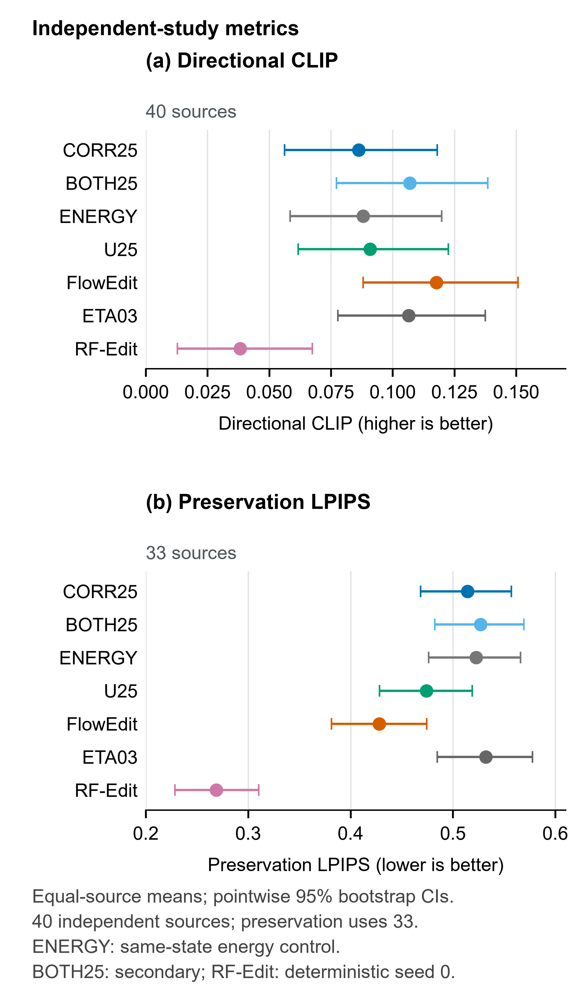
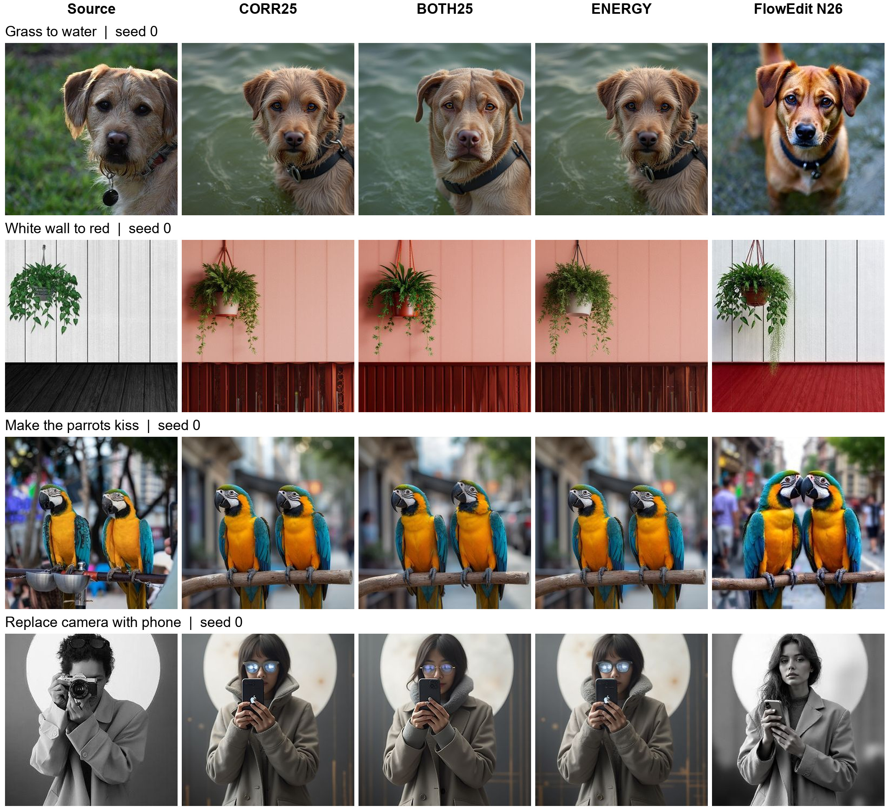

# TraceMemory

**Disentangling spatial allocation, correction dose, and source memory in rectified-flow image editing**

Updated **3 November 2026** with the mechanism-study interpretation and before/after factual-parser recovery sensitivity.

[Manuscript PDF](paper/main.pdf) · [LaTeX source](paper/main.tex) · [Development controls](paper/development_dose.tex) · [Final evaluation](paper/final_evaluation.tex) · [Run instructions](docs/REPRODUCING_FINAL.md) · [Download packages](https://github.com/leiyurun3-sudo/rf-trace-memory/releases/tag/evaluated-r84-r85-20261102)

## Research question and controlled interventions

Text-guided editing must change the requested attributes while preserving unaffected content. TraceMemory investigates how the **location, magnitude, and memory coverage** of source correction affect this balance.

The pre-registered routing arm is **CORR25**, recorded as `RELEASE_CORR25` in the plans and results. Three source/target prompt-response probes on an inverted reference define an edit-response map. Its complement supplies a soft protection weight. The method applies the protected residual directly, with coefficient 0.25, and uses paired source K/V memory during the first seven editing steps.

For reference states $r_i$, edited state $z_i$, and positive generation interval $h_i$:

$$
p_i=\frac{r_{i+1}-r_i}{h_i},\qquad c_i=p_i-u_i^s(z_i),\qquad P=1-0.75E.
$$

$$
z_{i+1}=z_i+h_i\left[u_i^{t,M}(z_i)+0.25P\odot c_i\right].
$$

The response $E$ is estimated from native source/target field differences at three reference nodes. It uses source and target prompts; benchmark edit masks enter evaluation only. The target velocity acts over the full image. Memory preserves the native target-text contribution and image-attention mass at each modified layer. The routing arm uses **direct local scaling without global RMS restoration**. Earlier `ONLINE` configurations are retained as historical controls.

The `ENERGY_MATCH25` control applies

$$
\widehat c_i^{\rm energy}=0.25\frac{\mathrm{RMS}(P\odot c_i)}{\mathrm{RMS}(c_i)}c_i.
$$

This matches the local rule's correction RMS at a common state while keeping its global direction. Each arm follows its own trajectory. The paired experiment compares allocation policies with common-state calibration. Subsequent state evolution changes realized dose: mean cumulative injection is 0.18074 for CORR and 0.18269 for ENERGY; the source-averaged relative difference is −1.02%, and the largest absolute single-step difference is 9.53%. Random, shifted, shuffled-prompt, and oracle request-support controls remain separate evidence gaps.

`RELEASE_BOTH25` is the pre-registered memory-release arm: it additionally weights memory queries by protection support. The primary/secondary roles in the frozen plan record selection history rather than a performance ranking.

## Final evaluated results

**650 outputs completed, zero generation failures, and automatic evaluation completed for all outputs.** R84 contains 130 development outputs on ten sources. R85 contains 520 outputs on 40 new sources, balanced across ten PIE-Bench categories. Six methods use two seeds per source; deterministic RF-Edit uses one run per source.

The table reports equal-source means. Preservation LPIPS and preservation MAE use the 33 sources with nonempty preservation masks; full-image and semantic metrics use all 40 sources. CLIP and DINO are cosine-based automatic scores. NFE counts standalone transformer calls, including inversion, memory capture, and response probes.

| Method | CLIP target ↑ | Directional CLIP ↑ | DINO ↑ | LPIPS full ↓ | LPIPS preserved ↓ | Preserved MAE ↓ | NFE |
|---|---:|---:|---:|---:|---:|---:|---:|
| CORR25 routing arm | 0.2629 | 0.0863 | 0.5904 | 0.5419 | 0.5142 | 0.1169 | 97 |
| BOTH25 memory release | 0.2733 | 0.1069 | 0.5579 | 0.5620 | 0.5269 | 0.1221 | 97 |
| Same-state energy control | 0.2622 | 0.0881 | 0.5856 | 0.5483 | 0.5226 | 0.1202 | 97 |
| Uniform correction, U25 | 0.2632 | 0.0908 | 0.6111 | 0.4971 | 0.4743 | 0.0972 | 91 |
| FlowEdit N26 | 0.2712 | 0.1177 | 0.5737 | 0.4437 | 0.4281 | 0.1207 | 52 |
| RF-Inversion ETA03 | 0.2694 | 0.1065 | 0.4670 | 0.5431 | 0.5322 | 0.1062 | 56 |
| RF-Edit I08 adapter | 0.2453 | 0.0383 | 0.7875 | 0.2778 | 0.2688 | 0.0455 | 100 |



### Findings

1. **Uniform correction retains source content more strongly at lower cost.** CORR25 minus U25 preservation LPIPS is **+0.0399**, with 95% source-bootstrap CI **[0.0331, 0.0469]**; preserved SSIM is −0.0359 and preservation MAE is +0.0196. All three six-comparison Holm-adjusted p-values are 0.0006. U25 uses 91 rather than 97 NFE.
2. **The allocation-policy effect is small and comparison-family sensitive.** CORR25 reduces preservation LPIPS by **0.0084** versus ENERGY, CI **[−0.0143, −0.0022]**. Adjusted p-values are 0.0238 for the six-contrast family, 0.0702 for all 21 pairs within the metric, and 0.2856 for the 66-numeric-test family. Full-image LPIPS decreases by 0.0064 and retains p = 0.0238 in the broad family. The contrast includes evolving dose and does not isolate request-localization quality.
3. **Memory release trades retention for semantic alignment.** BOTH25 increases directional CLIP by **0.0207** over CORR25, while preservation LPIPS increases by **0.0127** and DINO decreases by 0.0325.
4. **Retention depends on dose in the development sweep.** Increasing the local coefficient 0.15 → 0.25 → 0.35 changes preservation LPIPS **0.5544 → 0.4983 → 0.4561**. Semantic-score intervals span zero on these ten sources.
5. **FlowEdit N26 is a stronger measured semantic–LPIPS operating point.** Compared with CORR25, its directional CLIP is higher by 0.0315 and preserved LPIPS lower by 0.0861, at 52 versus 97 NFE. CORR25 improves DINO over ETA03 by 0.1234, with a corresponding semantic-retention trade-off.

The study characterizes correction allocation, magnitude, and memory within one FLUX.1-dev editor at 512×512. Rankings concern the measured operating points; CORR25 is not selected as the best editor.

### Statistical and evaluation protocol

Seeds are averaged within each source before inference. Reported paired intervals use source-bootstrap resampling; tests use source sign flips and Holm correction across the final six-comparison analysis family within each metric. The frozen plan specifies CORR25 versus FlowEdit as the primary comparison and assigns the added ETA03 comparison to a separate secondary family; the final exporter groups all six CORR25 comparisons within each metric. The manuscript appendix documents this grouping difference and broader-family sensitivity. Full numeric records retain the comparison family, sample counts, and unrounded estimates.

LPIPS preservation is a spatial-feature-map average weighted by the official edit-mask complement, with receptive-field spill across its boundary. Empty complements are excluded from that metric and counted explicitly. CLIP-T, directional CLIP, CLIP-I, DINOv2, LPIPS, PSNR, and SSIM exports are included. Task-specific evaluation uses frozen task rules, separate factual observations of source and output, and paired preservation judgments with anonymized method identities. Corrected factual-judge results are reported below; the automatic R84/R85 metrics above are unchanged.

### Exploratory factual-rule proxy (Qwen v2)

Local Qwen2.5-VL evaluated all 520 R85 outputs. Frozen factual rules require listed target conditions and an observed source-to-output change; protection is judged separately. These rules approximate, rather than fully encode, each instruction: giant presence omits lake-center location, watercolor omits Chinese style, and the rusty-iron sofa rule allows color changes despite a black-sofa target.

Counts below are **pass / fail / unknown**. Bounds are deterministic planned-output missing-label percentages: known passes divided by all planned outputs, through passes plus unknowns divided by all planned outputs. They are not confidence intervals or full-instruction accuracy.

| Arm | Outputs | Factual edit | Protected | Joint proxy | Bounds (%) |
|---|---:|---:|---:|---:|---:|
| CORR25 | 80 | 36 / 43 / 1 | 39 / 21 / 20 | 16 / 56 / 8 | 20.00–30.00 |
| BOTH25 | 80 | 42 / 38 / 0 | 38 / 18 / 24 | 19 / 48 / 13 | 23.75–40.00 |
| ENERGY | 80 | 35 / 45 / 0 | 37 / 19 / 24 | 14 / 57 / 9 | 17.50–28.75 |
| U25 | 80 | 40 / 40 / 0 | 41 / 16 / 23 | 20 / 51 / 9 | 25.00–36.25 |
| FlowEdit N26 | 80 | 41 / 39 / 0 | 41 / 21 / 18 | 16 / 52 / 12 | 20.00–35.00 |
| ETA03 | 80 | 42 / 38 / 0 | 34 / 28 / 18 | 16 / 58 / 6 | 20.00–27.50 |
| RF-Edit I08 | 40 | 4 / 36 / 0 | 25 / 6 / 9 | 3 / 36 / 1 | 7.50–10.00 |
| All outputs | 520 | 240 / 279 / 1 | 255 / 129 / 136 | 104 / 358 / 58 | 20.00–31.15 |

The archived joint event is factual edit AND protection AND no severe artifact, using three-valued logic. All 520 artifact calls report absence; the event therefore numerically equals factual edit AND protection. The artifact channel has only three clean controls, no positive-artifact controls, and is unvalidated and non-informative about defect sensitivity. All 15 factual/pair/clean controls passed; independent human calibration is absent. Protected content remains unknown for 26.2% of outputs.

Complete-source paired proxy estimates favor U25 over CORR25 (CORR−U25 −0.0606, pointwise CI [−0.1212, −0.0152], 33 sources); CORR−FlowEdit is 0.0000, CI [−0.1333, 0.1333], 30 sources. These use 5,000 paired source-bootstrap resamples without multiplicity adjustment. Output-dependent completion changes the selected source population, and planned-output bounds overlap.

**Recovery sensitivity.** Offline parsing recovers 48 observations and updates 51 dependent records without inference. With the same frozen rules and three-valued logic, joint counts change from 103/332/85 to 104/358/58. All **435 previously resolved joint labels remain unchanged**; 26 unknowns become failures and one becomes a pass. All six paired contrasts are unchanged on the fixed source intersection shared by both versions. Changes in each stage's own complete-source estimate arise from newly complete sources. The original archive already used the same conjunction logic: this sensitivity analysis makes no joint-logic correction.

[Before/after tables, CSVs, and fixed-cohort comparisons](results/QwenFactualV2/sensitivity) accompany the [corrected records](results/QwenFactualV2). Recompute the corrected aggregation without a model or images:

```bash
python tools/factual_qwen_audit/recompute.py qwen_recomputed
```

The [recovery sensitivity script](tools/factual_qwen_audit/recovery_sensitivity.py) also accepts the original pre-recovery result archive:

```bash
python tools/factual_qwen_audit/recovery_sensitivity.py /path/to/A_Qwen_FactualJudge_v2_results.zip sensitivity_recomputed
```

The old v6 judge is retained as evaluator-development provenance and excluded from the current comparison. A revised task-rule evaluation, positive-artifact calibration, and independent request-support controls would add evidence beyond this analysis.

### Qualitative examples



Columns: source, CORR25, BOTH25, energy control, FlowEdit N26. Rows: grass-to-water, wall-to-red, parrots-kissing, and camera-to-phone. The wall example illustrates localized attribute editing; FlowEdit more clearly achieves the requested parrot interaction. Dog and person outputs show identity or appearance changes. Population-level comparisons use the complete declared source set.

## Manuscript and local AI evaluation

The extended manuscript contains the method, experiments, statistical analysis, and appendices. It accompanies the executable evaluation code and archived numerical evidence.

The current factual-judge comparison is reproduced from the corrected records in `results/QwenFactualV2` using `tools/factual_qwen_audit/recompute.py`. Inference ran locally with Qwen2.5-VL-7B-Instruct; images were not uploaded. The earlier runner under `tools/local_qwen_judge` is historical, and its v6 scores are excluded from the current comparison.

## Files and reproduction

| Location | Contents |
|---|---|
| [paper/main.pdf](paper/main.pdf) | Updated extended manuscript and appendices |
| [paper/main.tex](paper/main.tex) | Manuscript source incorporating final evaluated results |
| [results/QwenFactualV2](results/QwenFactualV2) | Corrected factual-judge records, recovery audit, and summaries |
| [results/R85](results/R85) | Independent comparison: evaluation CSV, metrics, summaries, source-paired evidence |
| [results/R84](results/R84) | Development controls and dose response |
| [experiments/R84_R85_FinalNight](experiments/R84_R85_FinalNight) | Frozen code, plans, selectors, launchers, evaluators, and statistics |
| [docs/REPRODUCING_FINAL.md](docs/REPRODUCING_FINAL.md) | Environment, generation, evaluation-only restart, and package layout |
| [Release assets](https://github.com/leiyurun3-sudo/rf-trace-memory/releases/tag/evaluated-r84-r85-20261102) | Frozen 2 November package, numerical results, and manuscript snapshot; current PDF is linked above |
| [README_R71_R73.md](README_R71_R73.md) | Archived early timing/budget study; original code and results remain available |

The runnable ZIP contains benchmark inputs and frozen references needed by the nested launchers. Native generated PNGs remain on the experiment server for image-metric reevaluation; compact return packages provide thumbnails, comparisons, numerical results, and small logs. Historical absolute paths in frozen records preserve run provenance. The reproduction guide identifies the runtime root and restore procedure.

Rebuild the final figure from checked-in numerical evidence:

```bash
python paper/scripts/build_final_metrics.py \
  --summary results/R85/evidence/overnight_arm_summary.csv \
  --out paper/figures/final_metrics.pdf
```

Compile the manuscript from its directory with Tectonic:

```bash
cd paper
tectonic main.tex
```

Third-party model, dataset, and adapted-method terms remain applicable. Dataset provenance and original notices accompany the experiment snapshot and runnable package. Model weights are not redistributed here.
