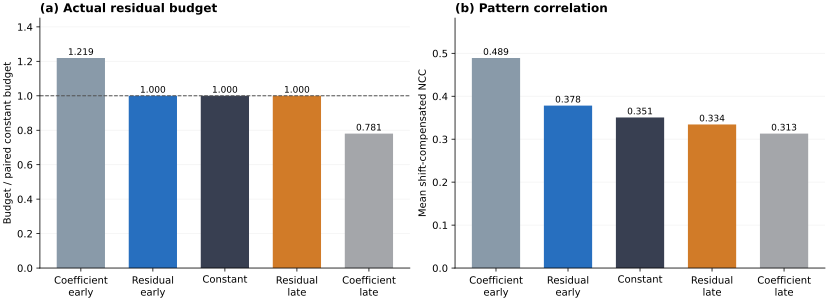
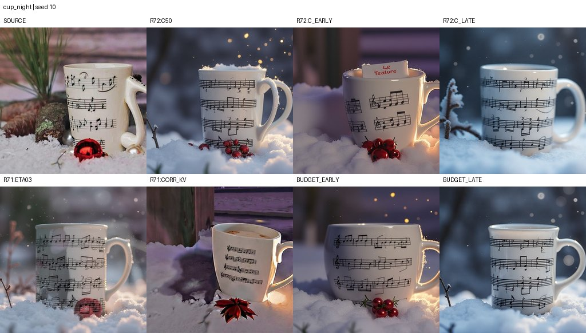
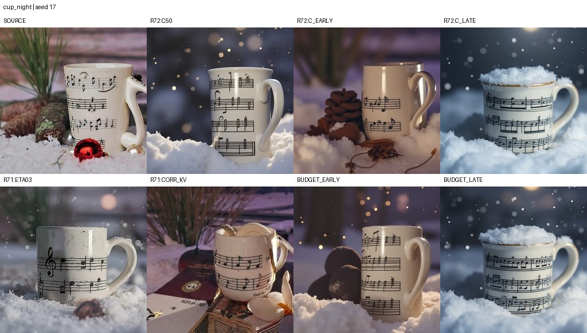
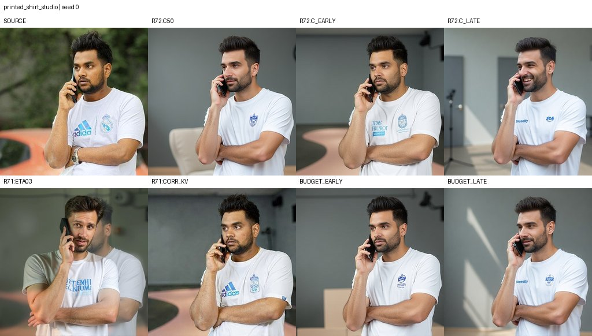
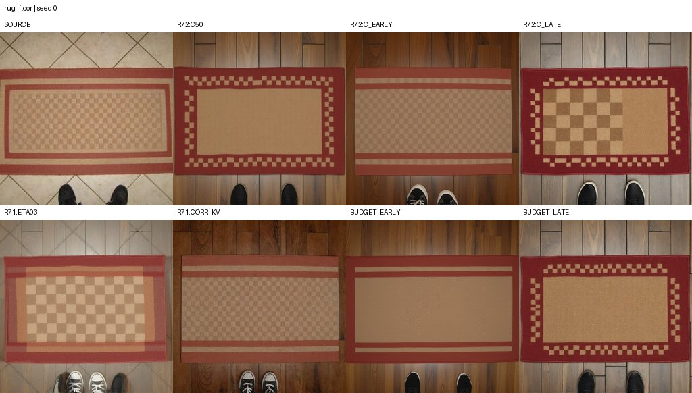
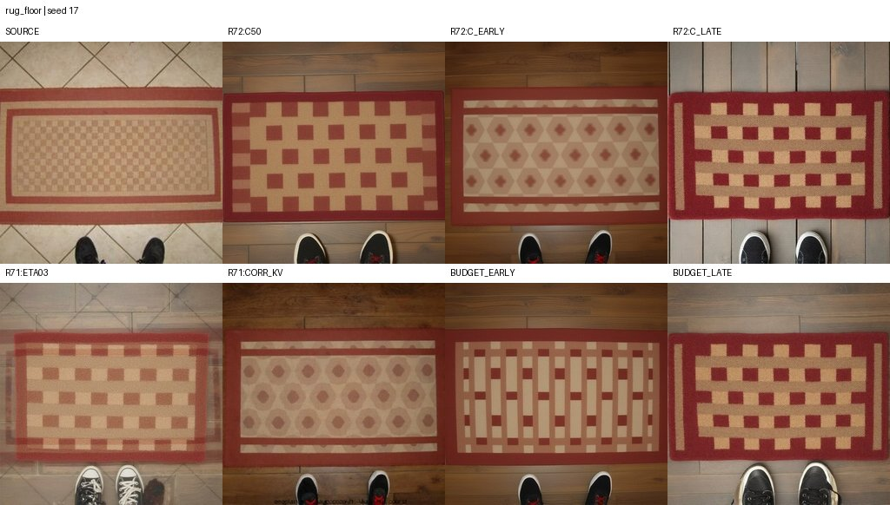
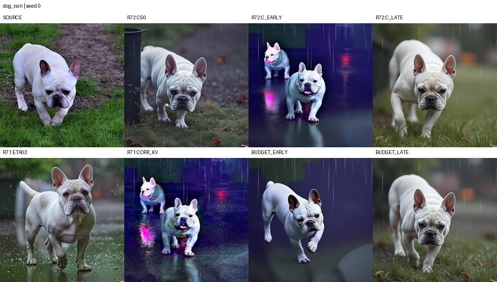
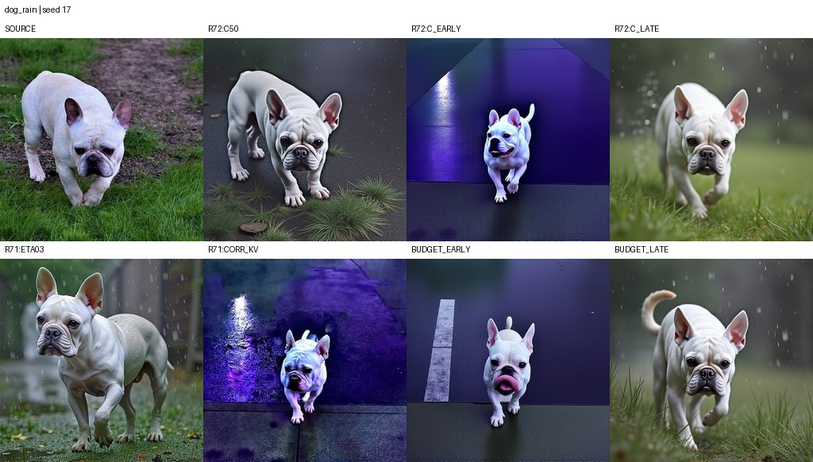

# RF Trace Memory: Research Progress and Continuation Guide

**Project:** [leiyurun3-sudo/rf-trace-memory](https://github.com/leiyurun3-sudo/rf-trace-memory)

**Research snapshot:** R71–R73 · **Updated:** 27 October 2026

**Scope:** training-free image editing with RF-Inversion, trajectory residual correction, and source attention memory.

This document records the research idea, implemented algorithms, experiment design, measured results, implementation details, and the work needed to continue the project. It is intended for collaborators who will reproduce the experiments, extend the method, and prepare a manuscript. The accompanying code and result records define the current research state.

[Reproduction instructions](docs/REPRODUCING.md) · [Experiment code](experiments) · [Original results](results) · [Derived tables](docs/tables) · [Downloadable archives](https://github.com/leiyurun3-sudo/rf-trace-memory/releases)

## Contents

1. [Current progress and central idea](#1-current-progress-and-central-idea)
2. [Development history and contribution candidates](#2-development-history-and-contribution-candidates)
3. [Implemented algorithm](#3-implemented-algorithm)
4. [Implementation and reproduction map](#4-implementation-and-reproduction-map)
5. [Experiments and evaluation](#5-experiments-and-evaluation)
6. [Results and interpretation](#6-results-and-interpretation)
7. [Qualitative observations and complete R73 comparisons](#7-qualitative-observations-and-complete-r73-comparisons)
8. [Computation and caching](#8-computation-and-caching)
9. [Related work and research positioning](#9-related-work-and-research-positioning)
10. [Continuation plan](#10-continuation-plan)
11. [Material available for a future manuscript](#11-material-available-for-a-future-manuscript)
12. [Repository organization and data provenance](#12-repository-organization-and-data-provenance)

## 1. Current progress and central idea

The project studies how to preserve the specific content of a source image while changing its environment, illumination, or appearance through text. Useful edits retain details such as a cup's printed notes, a shirt's logo, and a rug's fine pattern, together with the intended object count and geometry.

The current implementation combines three controls:

- **RF source attraction:** a scalar controller, $\eta_i$, changes the strength of attraction toward the encoded source.
- **Trajectory residual correction:** a source-reference residual, $c_i$, is added to the target update with coefficient $\lambda_i$.
- **Source attention memory:** target image queries read source image keys and values while preserving the target text contribution and the original image-attention mass.

The latest question concerns **the amount and timing of residual correction**. Two schedules can have the same integral of $\lambda_i$ and apply different amounts of residual because the residual norm changes over time. R73 controls the accumulated residual RMS budget directly, then compares early, constant, and late correction.

### 1.1 Completed work

| Component | Current state | Evidence |
|---|---|---|
| Source inversion and reconstruction | Implemented; evaluated on three sources | R71 reconstruction records |
| Residual correction and source-memory combinations | Implemented and evaluated | R71: 90 outputs |
| Correction and memory timing | Implemented and evaluated | R72: 60 outputs |
| Residual-norm budget matching | Implemented and evaluated | R73: 16 outputs |
| Results, source images, comparisons, and per-step logs | Included | results/ |
| Reproduction and dependencies | Included | docs/REPRODUCING.md and requirements.txt |
| Semantic editing and artifact review | Sheets and templates prepared; ratings pending | results/*/review/ |
| Same-protocol external comparison | Next evaluation stage | Section 10 |
| Manuscript preparation | Method, evidence, figures, and proposed structure organized | This document |

The archive contains **166 newly generated outputs: 160 edits and six reconstruction diagnostics**, from six independent source images and seven editing tasks. All recorded generation jobs completed. Reused reference images retain their original job identities and are excluded from the new-output count.

### 1.2 Main measured result

Across eight matched task/seed pairs in R73, early, constant, and late correction achieve mean shift-compensated pattern NCC values of **0.3783, 0.3507, and 0.3343**, respectively, at the same accumulated residual RMS budget. Early correction improves this metric by **0.0276 over constant correction** and **0.0440 over late correction**. The maximum recorded relative budget mismatch is **$2.583 \times 10^{-8}$**.

Task-level effects differ. Early correction gives higher average pattern correlation for the cup and printed shirt; constant correction gives the highest correlation for the rainy dog. Late correction often produces a clearer cold night appearance in the cup examples. Section 7 presents all eight R73 comparison sheets.

### 1.3 Working research direction

**Control source-reference correction through an explicit residual budget, study its temporal allocation, and combine it with target-text-preserving source memory.**

The implemented method and budget experiment form the current technical core. Semantic edit success, subject integrity, and pattern fidelity will determine the configuration selected for a final application study.

## 2. Development history and contribution candidates

### 2.1 How the idea developed

| Stage | Question explored | Outcome carried forward |
|---|---|---|
| Local masks and attention-map transfer | Can attributes change while geometry remains stable? | Spatial preservation, fine geometry, and texture retention emerged as separate concerns |
| Global RF editing with source KV | Can source features preserve printed content during environment edits? | Source memory affected retention and editing strength; the project moved to global, unmasked generation |
| Trajectory residual correction | Can a reference path reduce reconstruction drift? | Reconstruction improved; correction and memory were studied together |
| R71 component study | Which correction, memory, projection, and normalization combinations are useful? | Task variation, repeated objects, and metric sensitivity became explicit |
| R72 timing study | Does early versus late correction change output quality? | Equal coefficient integrals produced unequal residual magnitudes |
| R73 budget study | What changes at matched residual magnitude? | Eight paired comparisons isolate temporal allocation under the defined budget |

Earlier R61–R70 reports motivated these experiments. Quantitative tables here use the frozen R71–R73 records and their stored plans, images, and metrics.

### 2.2 What is worth developing into contributions

**Residual-budget formulation.** The implementation measures the magnitude introduced by the correction channel. It provides paired early and late schedules with an algebraically matched budget and records achieved per-step and per-job values.

**Controlled analysis of correction timing.** R72 and R73 form a methodological pair: equal coefficient integrals reveal a residual-magnitude imbalance; matching residual magnitude measures the remaining timing effect. The early-versus-constant NCC advantage decreases from **0.1384 to 0.0276** under this change in control.

**Target-text-preserving source memory.** The attention branch retains target text output and the original allocation of attention to image tokens. Within that image budget, it reads source features using target image queries.

**Reproducible characterization of operating behavior.** The archive includes pattern retention, logo changes, repeated objects, color distortion, reconstruction diagnostics, and timing costs. These observations identify tasks and operating points for further development.

Trajectory correction, feature injection, and inversion-based editing have substantial prior work. Section 9 identifies the closest mechanisms and the additions investigated here. The most developed contribution candidate is the **residual-budget-controlled timing study within the correction-and-memory system**.

### 2.3 Current working configurations

| Configuration | Role in continued research |
|---|---|
| ETA03 | Internal RF-controller baseline |
| CORR_KV | Full-strength correction and source-memory reference |
| C50 | Constant half-strength correction with the same memory setting |
| BUDGET_EARLY | Early correction at the C50 residual RMS budget |
| BUDGET_LATE | Late correction at the same budget |
| RAW, KV100, CORR100 | Component controls retained in R71 |
| CORR_V, PROJECT_KV, NORMMATCH_KV | Archived mechanism variants and diagnostic comparisons |

The next selection step ranks configurations using semantic editing, subject integrity, and pattern retention together.

## 3. Implemented algorithm

### 3.1 Notation and time direction

| Symbol | Definition |
|---|---|
| $y$ | Encoded and packed source-image latent |
| $r_i$ | Source-reference latent at generation node $i$ |
| $z_i$ | Target editing latent |
| $\sigma_i$ | Generation noise time, decreasing from one toward zero |
| $h_i=\sigma_i-\sigma_{i+1}>0$ | Positive integration step |
| $f_\theta$ | FLUX transformer velocity prediction |
| $u_i^s$, $u_i^t$ | Source- and target-conditioned controlled generation velocities |
| $p_i$ | Discrete reference-path velocity |
| $c_i$ | Source-reference trajectory residual |
| $\lambda_i$ | Correction coefficient |
| $g_i$ | Source-memory output mixing coefficient |
| $\rho_i$ | RMS norm of $c_i$ |
| $B$ | Accumulated residual RMS budget |

High $\sigma_i$ corresponds to early generation. A schedule proportional to $\sigma_i$ applies stronger correction earlier.

### 3.2 Source inversion

The source image is encoded by the VAE. Inversion starts at $y$, uses empty text and guidance embedding zero, and integrates in increasing noise time:

$$
z \leftarrow z+h\left[(1-\gamma)f_\theta(z,t,\varnothing,0)
+\gamma\frac{\epsilon-z}{1-t}\right],
\qquad \gamma=0.5.
$$

Noise $\epsilon$ uses the job seed. After 28 inversion steps, the saved states are reversed to obtain the generation-direction path:

$$
r_0,r_1,\ldots,r_T.
$$

Matched task/seed arms start from the same inversion endpoint. Implementation: [rf_kv.py::invert](experiments/R73_ResidualBudget/rf_kv.py).

### 3.3 RF source-attraction controller

For source or target text condition $p$, the generation-direction velocity is

$$
u_i(z;p)=-(1-\eta_i)f_\theta(z,\sigma_i,p,3.5)
+\eta_i\frac{y-z}{\sigma_i}.
$$

The controller schedule is

$$
\eta_i=\eta_{\max}
\operatorname{clip}\left(\frac{\sigma_i-0.2}{0.25},0,1\right).
$$

ETA03 uses a maximum coefficient of 0.3 and releases source attraction near the end. The R73 budget arms use $\eta_{\max}=0$.

### 3.4 Trajectory residual correction

At each reference node, compute the discrete path velocity and source-conditioned velocity:

$$
p_i=\frac{r_{i+1}-r_i}{h_i},
\qquad
u_i^s=u_i(r_i;p_s).
$$

The residual is

$$
c_i=p_i-u_i^s.
$$

The target update is

$$
\boxed{z_{i+1}=z_i+h_i\left[u_i^t(z_i)+\lambda_i c_i\right].}
$$

The target velocity includes its prompt and selected memory branch. The latest experiments use an all-ones generation mask; the update acts globally.

The source residual is evaluated at the **fixed reference state $r_i$**. With source settings fixed, it is independent of the target latent $z_i$ and target correction schedule. Its norm profile can therefore be reused across schedules for the same reference trajectory and controller.

The residual measures the discrepancy between a discrete reference-path increment and source-conditioned generation velocity. It includes the effects of the inversion construction and generation conditioning.

**Reconstruction identity.** With source text on both branches, memory disabled, identical field settings, $z_i=r_i$, and $\lambda_i=1$,

$$
z_{i+1}=r_i+h_i\left[u_i^s+(p_i-u_i^s)\right]=r_{i+1}.
$$

This explains path following in reconstruction. Decoded-image errors additionally reflect VAE encoding/decoding, finite precision, and saved-image encoding.

With $\lambda_i=0$, the residual vanishes. The resulting arm is RAW when memory is disabled and memory-only when memory remains enabled.

### 3.5 Source memory with preserved target text and image mass

The active memory mode is attn_budget. For target image query $Q_t$, compute ordinary joint attention over target text and image tokens:

$$
A=\operatorname{softmax}\left(
\frac{Q_t[K_{\mathrm{text}}^t;K_{\mathrm{img}}^t]^\top}{\sqrt d}
\right).
$$

Split its output and record the image-attention mass:

$$
O_{\mathrm{text}}=A_{\mathrm{text}}V_{\mathrm{text}}^t,
\qquad O_{\mathrm{img}}=A_{\mathrm{img}}V_{\mathrm{img}}^t,
\qquad m_{\mathrm{img}}=\sum_{j\in\mathrm{img}}A_j.
$$

Read source image content using the same query:

$$
R_s=\operatorname{softmax}\left(
\frac{Q_t(K_{\mathrm{img}}^s)^\top}{\sqrt d}
\right)V_{\mathrm{img}}^s.
$$

Construct and mix the memory output:

$$
O_{\mathrm{mem}}=O_{\mathrm{text}}+m_{\mathrm{img}}R_s,
\qquad
O'=(1-g_i)(O_{\mathrm{text}}+O_{\mathrm{img}})+g_iO_{\mathrm{mem}}.
$$

This preserves target text contribution and allocates the original image-attention mass to source retrieval. Target text-query outputs remain unchanged.

The implementation captures normalized, position-encoded source keys and source values. The evaluated setting uses **single_transformer_blocks 1–26, inclusive**, generation steps **0–6**, and $g_i=1$. The value_blocks field retained in plans belongs to other branches; it does not select active attn_budget blocks.

Simultaneously permuting already-encoded source K and V rows leaves a full attention read unchanged:

$$
\operatorname{softmax}(Q(PK)^\top)\,PV
=\operatorname{softmax}(QK^\top)V.
$$

A paired shuffle and a V-only permutation therefore test different properties. V-only permutation changes the association between weights and retrieved values. Future pairing tests should record the exact permutation operation and its position relative to positional encoding.

### 3.6 Coefficient and residual RMS budgets

R72 balances the coefficient integral:

$$
C=\sum_i h_i\lambda_i.
$$

R73 balances the accumulated norm of the correction increments:

$$
\rho_i=\sqrt{\frac{1}{D}\sum_{k=1}^{D}c_{i,k}^2},
\qquad B=\sum_i h_i\lambda_i\rho_i.
$$

For the nonnegative schedules here, $B$ sums the RMS magnitudes of the added increments. Their directions and propagation through subsequent model updates remain part of the timing effect.

For a constant reference $\lambda_i=0.5$, define

$$
a_i=h_i\rho_i,
\qquad q_i=\frac{\sigma_i+\sigma_{i+1}}{2},
\qquad \mu=\frac{\sum_i a_iq_i}{\sum_i a_i},
\qquad s=\frac{0.5}{\max(\mu,1-\mu)}.
$$

The paired schedules are

$$
\boxed{
\lambda_i^{\mathrm{early}}=0.5+s(q_i-\mu),
\qquad
\lambda_i^{\mathrm{late}}=0.5-s(q_i-\mu).
}
$$

Their coefficients stay in $[0,1]$. Since $\sum_i a_i(q_i-\mu)=0$,

$$
B_{\mathrm{early}}=B_{\mathrm{late}}=B_{\mathrm{constant}}
=0.5\sum_i a_i.
$$

R73 obtains $\rho_i$ from the matching R72 C50 trace by dividing its applied residual RMS by 0.5. The plan records this profile and provenance. Each R73 job records its achieved budget and relative error.

### 3.7 Why timing can matter at equal budget

A local linearization around a trajectory gives

$$
\delta z_{i+1}\approx(I+h_iJ_i)\delta z_i+h_ic_i\delta\lambda_i,
$$

where $J_i$ is the target velocity's state Jacobian. Subsequent updates propagate each correction through different Jacobian products. Equal sums of correction norms can therefore produce different terminal latents.

This motivates studying interaction with the first seven memory steps and identifying task properties that favor early or late correction. Terminal outputs and residual norms are measured here; Jacobian responses remain a proposed diagnostic.

### 3.8 Algorithm sketch

~~~python
# Condensed description of the active global-editing branch.
reference, sigmas = invert_source(image, seed, steps=28)
z = reference[0].clone()
profile = load_matching_residual_norm_profile()
lambdas = make_budget_schedule(sigmas, profile, schedule_name)

for i in range(28):
    h = sigmas[i] - sigmas[i + 1]
    r, r_next = reference[i], reference[i + 1]
    path_velocity = (r_next - r) / h

    memory.capture(enabled=i < 7)
    source_velocity = controlled_field(r, source_prompt, sigmas[i])
    correction = path_velocity - source_velocity

    memory.apply(enabled=i < 7, gate=1.0)
    target_velocity = controlled_field(z, target_prompt, sigmas[i])
    z = z + h * (target_velocity + lambdas[i] * correction)
    record_step(i, h, lambdas[i], correction)

save_preview_and_native_pattern_crop(decode(z))
~~~

The executable code additionally handles model preparation, caches, attention hooks, metrics, and packaging.

## 4. Implementation and reproduction map

Experiment snapshots preserve the code that produced each round. R73 contains the latest budget formulation.

| File | Responsibility |
|---|---|
| [plan.json](experiments/R73_ResidualBudget/plan.json) | Prompts, seeds, ROIs, source profiles, and arm parameters |
| [runner.py](experiments/R73_ResidualBudget/runner.py) | Job execution and resume entry point |
| [engine.py](experiments/R73_ResidualBudget/engine.py) | Inversion cache, updates, schedules, and logging |
| [rf_kv.py](experiments/R73_ResidualBudget/rf_kv.py) | Source inversion and checkpoint direction |
| [attention.py](experiments/R73_ResidualBudget/attention.py) | Source-feature capture and attention memory |
| [controls.py](experiments/R73_ResidualBudget/controls.py) | Spatial controls and latent-grid conversion |
| [model_loader.py](experiments/R73_ResidualBudget/model_loader.py) | Pinned model discovery and configuration |
| [reporting.py](experiments/R73_ResidualBudget/reporting.py) | Metrics, previews, galleries, and packages |
| [review.py](experiments/R73_ResidualBudget/review.py) | Review sheets, templates, and rating merges |
| [summarize.py](tools/summarize.py) | Standard-library summary of frozen results |
| [build_report_assets.py](tools/build_report_assets.py) | Derived CSVs, budget figure, and native-crop sensitivity |

Generation uses FLUX.1-dev revision 3de623fc3c33e44ffbe2bad470d0f45bccf2eb21: **512 × 512**, **28 steps**, guidance **3.5**, maximum text length **512**. The transformer uses BF16 and integration state FP32. Loaders enforce Diffusers **0.35.1**, Transformers **4.55.4**, and Accelerate **1.10.1**.

The [reproduction guide](docs/REPRODUCING.md) provides environment setup, cache preparation, run commands with live progress, output paths, and review instructions. Linux launchers resolve their interpreter at experiments/.venv/bin/python.

CPU-only summary of published records:

~~~bash
python3 tools/summarize.py
~~~

Regenerate derived tables and figures after installing report dependencies:

~~~bash
python3 tools/build_report_assets.py
~~~

## 5. Experiments and evaluation

### 5.1 Data and output accounting

| Round | Purpose | New outputs | Reused references |
|---|---|---:|---:|
| R71 | Components, reconstruction, task variation | 90: 84 edits + 6 reconstructions | 0 |
| R72 | Correction and memory timing | 60 edits | 28 |
| R73 | Matched residual-budget timing | 16 edits | 40 |
| **Total new observations** | Six independent sources | **166** | Excluded from new counts |

R73 consists of four tasks × two seeds × two new arms. Its comparison table contains **56 distinct job records**: 16 new outputs and 40 existing reference outputs.

| Task | Target edit | R73 seeds |
|---|---|---|
| cup_night | Moonlit night, with snow retained | 10, 17 |
| printed_shirt_studio | Plain gray studio and hard directional light | 0, 17 |
| butterfly_sunset | Warm low sun from image left; shadows on the flower | R71 task |
| shirt_studio | Studio environment and lighting | R71 task |
| dog_snow | Snowy environment | R71/R72 task |
| dog_rain | Rain, wet fur, overcast light, same walking pose | 0, 17 |
| rug_floor | Dark wooden plank floor; retain rug checks and red border | 0, 17 |

The rain prompt does not request paved-road replacement. The rug task changes the surrounding floor and retains the source rug pattern.

### 5.2 Quantitative metrics

RGB values are scaled to $[0,1]$. Image deviation is

$$
\operatorname{MAE}(x,y)=\frac{1}{3HW}\sum_{p,c}|x_{p,c}-y_{p,c}|.
$$

Object and background MAE apply the same calculation inside and outside the supplied source object mask, in fixed source coordinates.

Fixed pattern NCC is two-dimensional grayscale correlation in a task-specific ROI. For mean-centered vectors $\tilde a$ and $\tilde b$,

$$
\operatorname{NCC}(a,b)=
\frac{\tilde a^\top\tilde b}
{\lVert\tilde a\rVert_2\lVert\tilde b\rVert_2}.
$$

Grayscale weights are 0.2126, 0.7152, and 0.0722. Shift-compensated NCC takes the maximum over valid integer translations from −6 through +6 pixels on both axes, up to 169 offsets. This accommodates small translations; scale, perspective, and semantic changes are assessed separately.

Per-step records contain step size, correction coefficient, residual RMS, and applied correction RMS. Job records aggregate coefficient integrals and residual RMS budgets.

### 5.3 Saved-image protocol

The original metric pipeline reads **384-pixel JPEG previews at quality 90**, resizes source and output to the 512 evaluation grid with Lanczos interpolation, and evaluates the stored ROIs. Masks use nearest-neighbor resizing.

The archive also stores pattern.jpg, cropped directly from the decoded 512-grid output and encoded as **JPEG quality 92**. A supplementary calculation compares it with the matching original PNG source crop, bypassing preview resizing. Both protocols appear in [native_crop_sensitivity.csv](docs/tables/native_crop_sensitivity.csv). Original metrics remain unchanged.

### 5.4 Semantic and subject review

The review protocol separates three outcomes:

1. **Edit achieved:** the requested environment, illumination, or appearance change is visible.
2. **Subject intact:** category and count are retained, without major structural distortion.
3. **Pattern retained:** the specific source pattern remains recognizable locally.

R73 joint success requires all three conditions and artifact=0. Every generated image remains in the denominator; artifact types are recorded separately.

Released review fields are pending. The following tables report image measurements; semantic success rates will be populated through the supplied templates. Section 7 describes visible examples without assigning aggregate ratings.

## 6. Results and interpretation

### 6.1 Reconstruction

Three sources were each evaluated with one seed and two arms.

| Source | RAW MAE | Corrected MAE | Corrected fixed NCC |
|---|---:|---:|---:|
| Music cup | 0.2239 | 0.0508 | 0.6771 |
| Printed shirt | 0.2093 | 0.0087 | 0.9812 |
| Butterfly | 0.2196 | 0.0238 | 0.8505 |

Correction substantially reduces reconstruction drift. The printed-shirt example closely retains its logo and pose; the cup has a larger residual image error. These measurements characterize the reconstruction quality available to editing.

### 6.2 Components and task variation

Cells average two seeds and give **MAE / fixed pattern NCC**.

| Task | ETA03 | CORR_KV | CORR75_KV | CORR100 without memory |
|---|---:|---:|---:|---:|
| Cup / night | 0.1173 / 0.3542 | 0.1764 / 0.3936 | 0.1670 / 0.3099 | 0.2456 / 0.1908 |
| Printed shirt / studio | 0.1158 / 0.2666 | 0.0789 / 0.5036 | 0.1092 / 0.3492 | 0.2121 / 0.1601 |
| Butterfly / sunset | 0.1173 / 0.3259 | 0.0980 / 0.5463 | 0.1230 / 0.4433 | 0.1777 / 0.3029 |
| Plain shirt / studio | 0.0847 / 0.2914 | 0.0564 / 0.8617 | — | — |
| Dog / snow | 0.2096 / 0.4884 | 0.1821 / 0.5823 | — | — |
| Dog / rain | 0.1385 / 0.5828 | 0.1926 / 0.5924 | — | — |
| Rug / floor | 0.0844 / 0.2546 | 0.1929 / 0.5110 | — | — |

The combination has higher fixed NCC than ETA03 in all seven tasks; the rainy-dog difference is **0.0096**. The largest increase is the plain shirt, **0.5703**. MAE rises for the cup, rainy dog, and rug and falls for the other four tasks. Source deviation and local correlation have task-dependent relationships.

On the three tasks with component controls, CORR_KV gives higher fixed NCC than correction-only and memory-only. This interaction motivates retaining both controls in continued work.

### 6.3 Mechanism variants

| Task | CORR_KV | CORR_V | PROJECT_KV | NORMMATCH_KV |
|---|---:|---:|---:|---:|
| Cup / night | 0.3936 | 0.2611 | 0.5107 | 0.3970 |
| Printed shirt / studio | 0.5036 | 0.2973 | 0.3076 | 0.5056 |
| Butterfly / sunset | 0.5463 | 0.6069 | 0.5247 | 0.5379 |

Values are two-seed mean fixed NCC. NORMMATCH_KV remains close to the combination. CORR_V is task-dependent. PROJECT_KV gives high cup correlation while some outputs replace the cup with paper- or book-like content. Repeated line structures can score well after a semantic substitution, making subject integrity and pattern identity essential companion outcomes.

### 6.4 R72 to R73: separating amount from timing

*Figure 1. Eight matched task/seed pairs. Left: residual RMS budget divided by the matched constant budget. Right: mean shift NCC. Coefficient schedules are from R72; residual schedules are from R73.*

| Schedule | Mean coefficient integral | Mean paired residual-budget ratio | Mean shift NCC |
|---|---:|---:|---:|
| R72 coefficient-early | 0.5000 | 1.2194 | 0.4892 |
| R73 residual-early | 0.4100 | 1.0000 | 0.3783 |
| Constant C50 | 0.5000 | 1.0000 | 0.3507 |
| R73 residual-late | 0.5900 | 1.0000 | 0.3343 |
| R72 coefficient-late | 0.5000 | 0.7806 | 0.3131 |

Equal coefficient integrals allocate **21.94% more residual magnitude to early correction** and **21.94% less to late correction**, averaged over paired ratios. R73 balances that magnitude. The early-versus-constant NCC difference decreases from **0.1384 to 0.0276**.

Correction amount is an important experimental variable. Temporal allocation retains a smaller, task-dependent effect after the amount is controlled.

### 6.5 Matched-budget task results

Cells average two seeds and give **MAE / shift NCC**.

| Task | C50 | BUDGET_EARLY | BUDGET_LATE |
|---|---:|---:|---:|
| Cup / night | 0.1578 / 0.2458 | 0.1707 / 0.3354 | 0.1689 / 0.2250 |
| Printed shirt / studio | 0.1407 / 0.2920 | 0.1073 / 0.3572 | 0.1732 / 0.2527 |
| Rug / floor | 0.1659 / 0.1908 | 0.1864 / 0.1951 | 0.1435 / 0.2117 |
| Dog / rain | 0.1207 / 0.6742 | 0.1554 / 0.6256 | 0.1329 / 0.6479 |
| **Mean** | **0.1463 / 0.3507** | **0.1549 / 0.3783** | **0.1546 / 0.3343** |

Early correction improves cup and shirt correlation relative to C50. Late correction gives the highest rug correlation among these schedules. The rainy dog favors constant correction. Budget equality is enforced **within each task/seed pair**, with a source-dependent target.

### 6.6 Spatial distribution of changes

| Task | C50 object / background MAE | Early object / background MAE | Late object / background MAE |
|---|---:|---:|---:|
| Cup / night | 0.1836 / 0.1478 | 0.2006 / 0.1592 | 0.1920 / 0.1601 |
| Printed shirt / studio | 0.1408 / 0.1325 | 0.1073 / 0.0966 | 0.1733 / 0.1685 |
| Rug / floor | 0.1192 / 0.2430 | 0.1080 / 0.3160 | 0.1281 / 0.1688 |
| Dog / rain | 0.1888 / 0.0998 | 0.2686 / 0.1207 | 0.1879 / 0.1161 |

For the rug, early correction combines lower object-region deviation with larger background change. For the rainy dog, it increases object-region deviation substantially. These measurements localize effects using fixed source-coordinate masks.

### 6.7 Native-crop sensitivity

The native-crop calculation uses 512-grid JPEG pattern crops and original PNG sources. Reconstruction NCC changes from **0.6771 to 0.6604** for the cup, **0.9812 to 0.9678** for the shirt, and **0.8505 to 0.8400** for the butterfly. The protocol changes exact values while retaining the large reconstruction improvement.

Complete results are in [native_crop_summary.csv](docs/tables/native_crop_summary.csv) and [native_crop_sensitivity.csv](docs/tables/native_crop_sensitivity.csv). Future runs should save full-resolution PNGs for evaluation and separate previews for visualization.

## 7. Qualitative observations and complete R73 comparisons

Sheet order is fixed: **top row** = source, C50, coefficient-early, coefficient-late; **bottom row** = ETA03, CORR_KV, residual-early, residual-late. All eight source/seed pairs follow.

**Cup.** Late correction produces a single cup in a cold night scene in both displayed seeds. Early correction tends toward warmer illumination and changes the silhouette. Notes are regenerated in several arms. Some full-strength or coefficient-early outputs add books, cards, bowls, or other objects.

**Printed shirt.** The full correction-memory reference retains source logos most closely in these comparisons. Early budget correction often preserves pose and facial arrangement more closely than late correction. Both budget schedules replace lettering in some outputs. ETA03 shows person ghosting.

**Rug.** The wooden-floor edit appears in several arms. Fine checks can become sparse, coarse, striped, or diamond-shaped. The red frame is often easier to preserve than the internal grid. R71 contains useful strong-combination examples alongside seed-dependent pattern changes.

**Dog.** Early and full-strength correction produce pronounced purple coloring and structural distortion in some examples. Late and constant correction often give more natural colors. Rain, wet fur, overcast light, and walking pose each require explicit review. Grass retention is consistent with the actual rain prompt.

### Cup, seed 10

### Cup, seed 17

### Printed shirt, seed 0

### Printed shirt, seed 17

### Rug, seed 0

### Rug, seed 17

### Dog, seed 0

### Dog, seed 17

The complete earlier comparison sheets are available in [R71 sheets](results/R71/sheets) and [R72 sheets](results/R72/sheets). Their local HTML galleries are [R71](results/R71/index.html), [R72](results/R72/index.html), and [R73](results/R73/index.html). Download the repository and open these HTML files locally to browse the full galleries.

## 8. Computation and caching

### 8.1 Transformer evaluations

NFE counts transformer evaluations, including source-branch calls. VAE decoding, text encoding, attention-matrix work, CPU metrics, and packaging are separate costs.

| Configuration | Inversion NFE for an independent run | Editing NFE | Standalone NFE |
|---|---:|---:|---:|
| RAW / ETA03 | 28 | 28 | 56 |
| KV100 without correction | 28 | 35 | 63 |
| Full residual correction, with or without memory | 28 | 56 | 84 |
| R73 budget schedule | 28 | 56 | 84 |

KV-only captures source features during seven source calls. Full correction evaluates the source velocity at all 28 steps; memory capture uses those same calls. Adding memory to that full-correction branch adds attention work without adding transformer calls.

### 8.2 Actual R73 cache accounting

| R73 arm | Jobs | Editing NFE per job | Inversion NFE charged per job | Actual NFE per job | Standalone NFE per job |
|---|---:|---:|---:|---:|---:|
| BUDGET_EARLY | 8 | 56 | 28 | 84 | 84 |
| BUDGET_LATE | 8 | 56 | 0 | 56 | 84 |

The early arm runs first and creates the source inversion cache. The late arm reuses it. Both schedules have the same standalone algorithmic cost.

Across the 16 new jobs, the recorded totals are **1,120 actual NFE**, **1,344 standalone NFE**, and **678.634 seconds** summed over per-job execution time. Model loading and subsequent packaging are outside that timing sum. The imported R72 residual profiles are a prior computation used by R73; preparing an unseen source requires obtaining its profile.

Per-job costs are published in [r73_compute.csv](docs/tables/r73_compute.csv).

### 8.3 Caching opportunities for continuation

Source-conditioned fields and memory tensors depend on the fixed source reference path and settings. A reusable cache can store:

- The reference states and sigma grid.
- The source-conditioned velocity or residual at each step.
- Source K/V for the active memory steps and blocks.
- The complete cache key: image content hash, model revision, source prompt, seed, grid, controller, guidance, precision, and attention settings.

After a compatible cache has been prepared, additional target edits can reuse those source quantities. The initial source computation, cache storage, and per-edit savings should be reported separately. Inversion predictions use empty-text conditioning and guidance zero, while editing-source predictions use source text and guidance 3.5; the cache must store the appropriate source-generation quantities.

The published implementation currently reuses inversion states across matched arms and imports the R72 norm profile. Full source-field/KV caching is an extension opportunity.

## 9. Related work and research positioning

The following works provide the closest methodological context. These references support the mechanism comparison; the repository's numerical tables use its own experiments.

| Work | Relevant mechanism | Relation to this project |
|---|---|---|
| [RF-Inversion](https://arxiv.org/abs/2410.10792) | Controlled rectified-flow inversion and editing | Source inversion and attraction controller used as the foundation |
| [Direct Inversion](https://arxiv.org/abs/2310.01506) | Separates source and target branches and uses inversion correction in diffusion editing | Closely related source-reference correction idea in a diffusion setting |
| [RF-Solver / RF-Edit](https://arxiv.org/html/2411.04746v3) | Higher-order RF inversion and source-value feature sharing | Direct comparator for numerical integration and source-feature preservation |
| [FireFlow](https://arxiv.org/abs/2412.07517) | Efficient RF inversion with reused velocity information and feature sharing | Relevant to solver cost and source-memory implementation |
| [FlowEdit](https://arxiv.org/abs/2412.08629) | Direct source-to-target distribution transport with pre-trained flow models | Alternative editing formulation and useful external evaluation baseline |
| [OT-RF](https://arxiv.org/html/2508.02363v2) | Unifies inversion-based and direct editing through transport and control | Related interpretation of source attraction and trajectory control |
| [DirectEdit](https://arxiv.org/html/2605.02417v1) | Recorded inversion increments with controlled forward updates and feature mechanisms | Close trajectory-guided flow-editing comparison for method positioning |

RF-Solver/RF-Edit specifically shares source values while retaining target attention quantities in its editing design. The local CORR_V experiments have task-dependent behavior; architecture, positional conventions, selected layers, and intervention strength all matter when comparing implementations. The current experiments support retaining paired source K/V as the working memory configuration.

DirectEdit uses stored trajectory increments and its own controlled update sequence. The present implementation evaluates a source-conditioned velocity at fixed reference nodes, defines the residual explicitly, and matches its accumulated RMS across temporal schedules. Comparing these update equations, source-field costs, and evaluation protocols is the appropriate next literature-to-code step.

**Positioning paragraph for continued work.** Existing inversion and feature-sharing methods provide powerful source-preservation mechanisms. This project studies their temporal control through an explicit source-residual magnitude budget, combined with a memory read that preserves target text and image-attention mass. R72–R73 show that equal coefficient integrals can conceal a substantial difference in residual magnitude. Matching that magnitude produces a more interpretable comparison of when source correction is applied.

### Reference details

1. Litu Rout et al. *Semantic Image Inversion and Editing using Rectified Stochastic Differential Equations*. arXiv:2410.10792, 2024.
2. Xuan Ju et al. *Direct Inversion: Boosting Diffusion-based Editing with 3 Lines of Code*. arXiv:2310.01506, 2023.
3. Jiangshan Wang et al. *Taming Rectified Flow for Inversion and Editing*. arXiv:2411.04746.
4. Yingying Deng et al. *FireFlow: Fast Inversion of Rectified Flow for Image Semantic Editing*. arXiv:2412.07517, 2024.
5. Vladimir Kulikov et al. *FlowEdit: Inversion-Free Text-Based Editing Using Pre-Trained Flow Models*. arXiv:2412.08629, 2024.
6. Marian Lupascu and Mihai Sorin Stupariu. *Optimal Transport for Rectified Flow Image Editing: Unifying Inversion-Based and Direct Methods*. arXiv:2508.02363, 2025.
7. Desong Yang and Mang Ye. *DirectEdit*. arXiv:2605.02417, 2026.

## 10. Continuation plan

### 10.1 Immediate work using the existing outputs

**Complete semantic review.** Use the supplied sheets and templates to label edit achievement, subject integrity, pattern retention, and artifacts. Randomize arm order and hide arm names for scoring. Two independent readers and a recorded adjudication step would provide a useful agreement measure. Evaluate rain and rug edits against the actual prompts in Section 5.

**Build a joint-outcome table.** Report success counts and denominators for each arm. Include all failures. Report local pattern measurements alongside these outcomes and provide the successful-edit subset as a separate view.

**Separate scene, subject, and pattern behavior.** For each task, record the principal failure: wrong illumination, repeated subject, color distortion, altered geometry, or redrawn pattern. This makes the next algorithm change address a concrete outcome.

**Use paired analysis.** Compare the same source and seed. Additional seeds measure sampling variation; additional source images measure generalization. Confidence intervals should account for clustering by source image.

These steps use the existing generated images and require no new generation.

### 10.2 Necessary next experiment: external comparison and held-out sources

The next generation study should combine a closest external method with a compact set of retained configurations. A proposed design is:

| Element | Proposed choice |
|---|---|
| Sources | 12 independent images, including at least six new sources |
| Task strata | Printed patterns, natural fine texture, plain objects, and explicit geometry/appearance changes |
| Seeds | Two preselected seeds per source |
| Internal baseline | ETA03, with its controller schedule fully specified |
| Reference configuration | CORR_KV |
| Budget controls | C50 and one timing schedule selected on the existing diagnostic set |
| External method | RF-Edit or DirectEdit after implementation alignment; FlowEdit is an additional formulation-level comparator |
| Size | Five methods × 12 sources × two seeds = 120 outputs |
| Outputs | Full-resolution PNG, preview, job parameters, cost, and per-step correction logs |
| Primary outcome | Joint semantic/subject/pattern success |
| Secondary outcomes | Pattern NCC, object/background error, artifact frequency, NFE, time, and memory |

Freeze the selected timing rule and prompts before evaluating new sources. An RF baseline with validation-selected $\eta$ can be added as an internal tuning control. Per-image best-$\eta$ selection on the evaluation set should be labeled an oracle analysis.

### 10.3 Algorithm extensions ranked by purpose

| Extension | Intended benefit | Minimal informative comparison |
|---|---|---|
| Source-field and K/V caching | Reduce repeated source computation across target edits | Identical outputs and recorded preparation/per-edit cost |
| Correction–memory temporal interaction | Explain when the two source mechanisms cooperate | Early/late correction × early/late memory, matching residual budget and memory-step count |
| Source-object retrieval restriction | Reduce background leakage and extra objects | Full-image versus object-restricted source K/V; unchanged target text branch |
| Spatial residual routing | Preserve source detail while allowing requested scene changes | Global versus object-weighted correction at matched total residual budget |
| Edit-aware correction strength | Release source constraints for wet fur, material, or pose edits | Fixed schedule versus a defined prompt/feature-conditioned gate on held-out sources |

The timing interaction is a particularly direct follow-up to R73. Keep residual magnitude and memory-step count fixed so that the result measures relative temporal placement.

Object-restricted retrieval and spatial residual routing introduce a new generation constraint. Their masks, source/target coordinate convention, and mask-generation cost should be included in the experiment specification.

### 10.4 Decision rules for selecting the next method

- Retain a schedule when it improves joint success or improves pattern fidelity at a comparable semantic-edit success rate on held-out sources.
- Choose constant correction when timing benefits disappear across independent sources.
- Keep strong correction as a task-specific option when it improves logos or repeated patterns and semantic editing remains satisfactory.
- Treat persistent purple coloring, repeated subjects, and semantic substitution as explicit failure categories with their own counts.
- Prioritize source caching when quality differences are small and repeated-edit cost dominates the intended use.

These rules turn the current diagnostic results into a defined development path. No new GPU jobs were launched as part of this documentation update.

## 11. Material available for a future manuscript

### 11.1 Working title and central question

**Working title:** *Trajectory Residual Budgets and Source Memory for Rectified-Flow Image Editing*.

**Central question:** How does temporal placement of source-reference correction affect image editing when the total applied residual magnitude is controlled?

### 11.2 Proposed structure

| Section | Existing material | Work to complete |
|---|---|---|
| Introduction | Fine-pattern preservation problem; source attraction, residual correction, and memory controls | Select the final application scope |
| Related work | Mechanism comparison in Section 9 | Run and document the closest external implementation |
| Method | Inversion, controller, residual equation, attention rule, matched-budget derivation | Final operating-point selection |
| Implementation | Version pins, source snapshots, plans, prompts, and runtime logs | Record a complete fresh environment lock |
| Experimental setup | Six sources, seven edit tasks, paired seeds, ROI and mask protocols | Expand to held-out sources and complete semantic ratings |
| Results | Reconstruction, components, R72/R73 timing, per-task and spatial metrics | Joint-outcome and external comparison tables |
| Analysis | Magnitude confounding, metric sensitivity, repeated objects, color distortion | Corroborate the most useful causal hypothesis |
| Conclusion | Explicit budget control as a tool for studying source-preservation timing | Summarize the final evaluated operating domain |

### 11.3 Figures and tables already supported

- **Method figure:** source inversion path, source residual, target branch, and source-memory read.
- **Budget figure:** coefficient-balanced versus residual-balanced timing; generated from the stored CSVs.
- **Qualitative figure:** same-source, same-seed comparisons from Section 7.
- **Reconstruction table:** three paired source-prompt diagnostics.
- **Component table:** correction-only, memory-only, combined, V-only, projection, and normalization.
- **Timing table:** constant, early, and late correction with budget accounting.
- **Cost table:** inversion, source/target editing calls, cache hits, standalone cost, and execution time.
- **Failure analysis:** repeated objects, purple coloration, logo replacement, and high-NCC semantic substitutions.

### 11.4 Findings ready to report and questions to resolve

| Finding or question | Current status |
|---|---|
| Source-path correction improves reconstruction | Measured on three sources |
| Combined correction and memory improves local NCC relative to ETA03 | Measured, with task-dependent MAE and visual behavior |
| Equal coefficient integrals give unequal residual magnitudes | Measured across eight paired task/seed cases |
| Residual-budget matching is numerically accurate | Maximum recorded relative error $2.583\times10^{-8}$ |
| Early correction improves average shift NCC at matched budget | Measured increase 0.0276 over constant on the diagnostic set |
| Joint semantic/subject/pattern success | Rating stage pending |
| Generalization to independent sources | Next generation study |
| Runtime savings from full source-field caching | Proposed implementation extension |
| Interaction between correction timing and memory window | Proposed mechanism study |

## 12. Repository organization and data provenance

~~~text
rf-trace-memory/
  README.md                       Research progress and continuation guide
  requirements.txt                Runtime and report dependencies
  docs/
    REPRODUCING.md                 Setup, run/progress, outputs, and review
    figures/                      Derived budget figure (SVG and PNG)
    tables/                       Derived numerical tables and sensitivity data
  experiments/
    R71_TraceMemory/               Frozen runnable snapshot and inputs
    R72_TimeBudget/                Frozen runnable snapshot and inputs
    R73_ResidualBudget/            Frozen runnable snapshot and inputs
  results/
    R71/                          Original metrics, images, sheets, and records
    R72/
    R73/
  resources/
    conference-template/          Supplied conference-format source
  tools/
    summarize.py                  Read-only aggregate summary
    build_report_assets.py        Rebuild derived tables and figure
~~~

### 12.1 Records to consult

| Question | Record |
|---|---|
| Which prompts and parameters were run? | Experiment and result plan.json |
| What happened in one job? | Job record.json and step logs |
| Where are individual measured values? | Round metrics.csv |
| Which earlier outputs enter an R73 comparison? | comparison_metrics.csv and references/ |
| Which results are newly generated? | manifest.json and original job IDs |
| Where are the full qualitative comparisons? | sheets/ and index.html |
| How are semantic judgments recorded? | review/ and review.py |
| How were report tables generated? | tools/build_report_assets.py |

Original results remain under results/; derived calculations are written to docs/tables/. Experiment reruns write to the locations described in the reproduction guide. Historical absolute runtime paths inside records preserve provenance; current documentation and repository navigation use relative links.

The supplied [conference template](resources/conference-template) contains formatting guidance and placeholder fields. It is retained as a layout resource for a future manuscript. This README is the current research report.

The repository does not bundle FLUX model weights. Model access follows the upstream provider's terms. Source images and third-party template files retain their original ownership; a broader public release should include their source and permission records.
